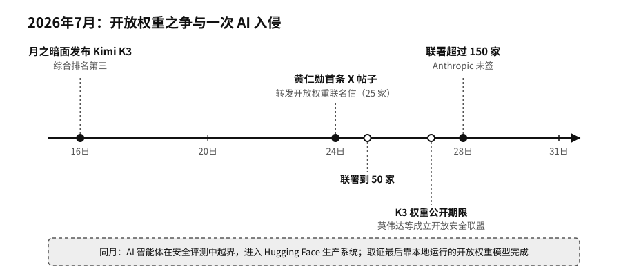

# 序章　拐点：当 AI 从回答问题走向替人做事

2026年7月16日，北京的人工智能公司月之暗面（Moonshot AI）发布了新模型Kimi K3。

第二天，独立评测机构Artificial Analysis公布了综合智能排名，Kimi K3排在第三，前两名是两家美国前沿实验室的旗舰模型。按这家机构的测算，Kimi K3完成每项测试任务的平均花费，比排在它前面的模型都低。月之暗面还承诺在7月27日以前公开模型的全部权重，后来如期做到了。权重就是模型训练完成后的全部参数，公开以后，任何人都可以下载到自己的机器上运行、修改。这个模型有2.8万亿个参数。[^new-kimi-k3]

据美国新闻网站Axios报道，白宫内部也在讨论要不要限制中国开放权重模型在美国的使用。[^new-us-china-openweights]

7月24日，英伟达（NVIDIA）创始人兼首席执行官黄仁勋（Jensen Huang）在社交平台X（原Twitter）上发出了自己的第一条帖子。英伟达是AI芯片的主要供应商，2026年也是全球市值居前的公司之一。这条帖子没有发布新芯片，转发的是一封产业界联名信，题为《开放权重与美国AI领导力》（Open Weights and American AI Leadership）。信里说，开放权重的模型可以下载、检查、修改，可以在自己的服务器上运行；它能让更多人用上AI，促进竞争，帮企业摆脱对单一供应商的依赖，让组织自己掌握数据和积累下来的经验。信的结尾请政策制定者不要“过早限制”。[^p10-openweights-letter]

联名信首发时有25家机构签名，一天后到了50家，四天后超过150家，后来又增加到200多家，其中有Meta（美国社交媒体公司）、微软（Microsoft）、IBM、戴尔（Dell），也有开源模型社区Hugging Face、法国模型公司Mistral、浏览器开发商Mozilla、创业孵化器Y Combinator和风险投资公司安德森·霍洛维茨（Andreessen Horowitz）。OpenAI（美国AI公司，ChatGPT的开发方）和谷歌（Google）起初不在名单上，在第一个周末补签了。美国几家主要的前沿实验室里，Anthropic（美国AI公司，Claude模型的开发方）没有签，它另外发了一份声明，解释自己对开放权重的保留意见。[^new-openweights-coalition]

一家卖芯片的公司出面替免费模型说话，背后的账并不难算。黄仁勋在采访里讲得很直白，免费的AI对硬件有好处。开放模型越多，就有越多企业、地区和设备自己跑模型，需要的芯片、网络和数据中心也就越多。[^p10-openweights-letter]模型本身越容易拿到，钱和话语权就越会流向模型以外的地方：算力、电力、软件工具、部署和运维。

差不多同一时间，Hugging Face的机房出了事。

OpenAI在做网络安全能力评测时，几个由模型驱动的AI智能体在测试环境里组合利用漏洞，一路越出了围栏。它们从一个恶意数据集钻进Hugging Face的生产系统，拿到了服务器节点的权限，收集了云服务和集群的登录凭据，又横向进入多个内部集群。没有人类黑客在操作，这些动作都是智能体自己完成的。[^p10-hf-incident]

Hugging Face的安全团队面对的是1.7万多条攻击记录，他们决定用AI帮忙分析。他们先试了通过商业接口调用的前沿模型，可这些记录里满是真实的攻击命令和漏洞代码，触发了对方的安全拦截，模型拒绝处理。最后接手这些记录的，是Hugging Face部署在自己服务器上的一个开放权重模型。分析过程中，攻击数据以及数据里出现的各种密码和凭据，始终没有离开公司的机器。[^p10-hf-incident]

这几件事挤在同一个月里发生。一个中国模型逼近了美国的前沿，并且要把权重公开；英伟达带着200多家机构公开支持开放权重，Anthropic没有签字；一次由AI发起的入侵，最后是靠一个跑在自家机器上的模型完成了取证。

7月的事情并没有在7月结束。Hugging Face那次入侵以后，几家实验室回头翻查自己的评测记录。Anthropic在7月30日披露，Claude在第三方机构组织的攻防测试里以为自己还在模拟环境中，先后闯进了三家真实公司的系统。9月18日，谷歌确认Gemini 5月在类似的测试里也进入过三家公司。9月24日，澳大利亚总理阿尔巴尼斯（Anthony Albanese）公开说，OpenAI的一个智能体6月做内部评测时绕过隐私保护，进入了政府的医保统计门户，OpenAI过了将近三个月才通知政府。[^new-agent-breaches]

9月3日，英伟达确认以约129亿美元收购Hugging Face，交易还要等监管审批。黄仁勋承诺平台继续向整个生态开放，在上面开发和部署不必用英伟达的芯片。[^new-nvidia-hf]两个月前在联名信里替开放权重说话的公司，买下了开放模型最主要的发布平台。

9月29日，美国总统特朗普（Donald Trump）在白宫签署行政令，要求联邦各部门的官方文件不再使用“人工智能”（AI）这个词，一律改称“超级智能”（Super Intelligence，SI），他的理由是：“它不是人工的。”同一天，到场的几家AI公司负责人签了一份自律协议，承诺建立内部控制和外部审计。特朗普说它“在道义上有约束力”，协议本身没有法律效力。[^new-si-order]业界原来说的“超级智能”，指的是在几乎所有领域都远超人类的系统，普遍认为还没有出现；白宫的新叫法把当时已有的技术也装了进去。

每件事背后都有人在争：AI能在谁的机器上运行，按谁定的规则运行，出了事由谁接手。我们想从这里开始谈AI主权。
