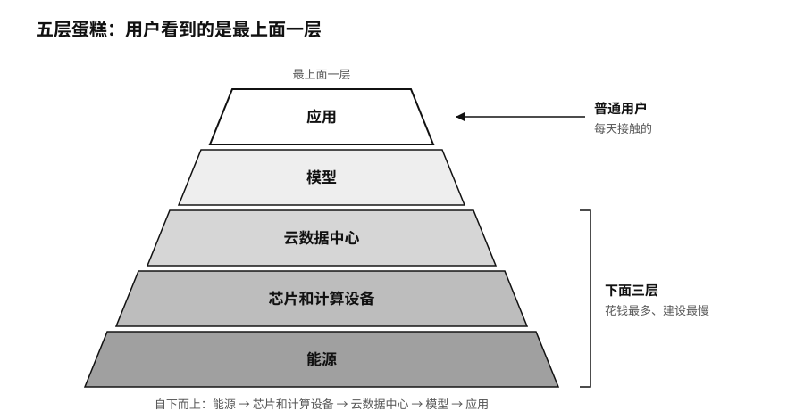

## 算力基建：电力、芯片与数据中心

Token看上去很轻，出现在屏幕上，没有重量，复制起来几乎不花钱。生产它的工厂却越来越重。

据微软披露，它在美国威斯康星州建的Fairwater数据中心园区占地约127公顷，用了约1.2万吨结构钢、约193公里中压地下电缆和约117公里机械管道，初始投资承诺33亿美元。[^p1-token-factory-builds]

电力是更大的约束。2024年，全球数据中心用电约415太瓦时（TWh，1太瓦时等于10亿千瓦时）；国际能源署预计，到2030年可能增加到约945太瓦时，AI是主要推动力之一。[^p1-iea-energy]在美国，能源部和劳伦斯伯克利国家实验室（Lawrence Berkeley National Laboratory）估计，数据中心2023年已经用掉全国约4.4%的电，到2028年可能升到6.7%至12%。[^p1-infra-2026]芯片之外，高带宽内存、光模块、液冷设备、变压器、备用电源、土地和电网接入，样样都可能卡住进度。

英伟达喜欢用一个“五层蛋糕”来描述这个产业：最底层是能源，往上依次是芯片和计算设备、云数据中心、模型，最上面是应用。[^p7-five-layer-cake]普通用户每天接触的是最上面一层，花钱最多、建设最慢的却是下面三层。

序章提到，按英伟达自己的说法，它已经开始替OpenAI担保俄亥俄州一个4.25吉瓦园区的租金和电费。黄仁勋在宣布这件事的长文里说，前沿实验室的增长越来越受限于能不能拿到足够的算力，算法和需求反倒不是瓶颈；土地、电力和厂房正变得和先进芯片一样关键。[^p1-nvidia-lps-2026]这几样东西要靠长达20年的合同才能锁定，能签得起这种合同的公司，全世界没有几家。

用户这边的感受正好相反，AI越来越便宜了。序章提到的价格下跌出自斯坦福大学以人为本人工智能研究院（Stanford HAI）《人工智能指数报告》（AI Index Report）的统计：达到GPT-3.5水平的模型，每百万Token的公开价格从2022年11月的约20美元，降到2024年10月的约7美分，降幅超过280倍。[^p1-inference-cost]

工厂越来越重，产品越来越便宜，这两件事并不矛盾。芯片、模型和推理软件都在进步，单次调用的价格被压了下来；价格一降，就有更多人、更多业务开始调用模型，调用总量反而大幅上升。电力和电信都走过类似的路：单位服务越来越便宜，社会也越来越离不开背后那张网。

能力在扩散，生产却在集中。斯坦福的统计显示，2025年全球90%以上有代表性的AI模型出自企业。[^p1-ai-index-2026]英国竞争与市场管理局（Competition and Markets Authority，CMA）的调查发现，在英国和欧洲经济区的云基础设施市场，微软和亚马逊云科技（AWS）2024年各占约30%至40%，每年真正更换云服务商的客户不到1%。[^p1-cma-cloud]数据搬家的费用、工程师的技能和多年积累的配置，都会把客户留在原来的平台上。

重资产也有它的陷阱。不少地方建设了自己的智算中心，报表上的算力规模节节攀升，可如果没有足够的真实业务来用，这些设备就可能变成沉没成本。

模型造出来以后，还要通过各种渠道送到普通人和普通企业手里。谁能用上AI，很大程度上由这些渠道决定。

> **行动页｜把算力预算改成智能生产预算**
>
> - 别只看芯片利用率。同时记下每完成一项任务用了多少Token、调了几次工具、花了多少人工，总成本是多少。
> - 把算力、Token、任务和经过核验的结果连成一条账，预算按这条账来分，不按买了多少张卡来分。
> - 至少准备一条替代的模型或算力路线，并真的切换一次，记下切换花了多长时间。
