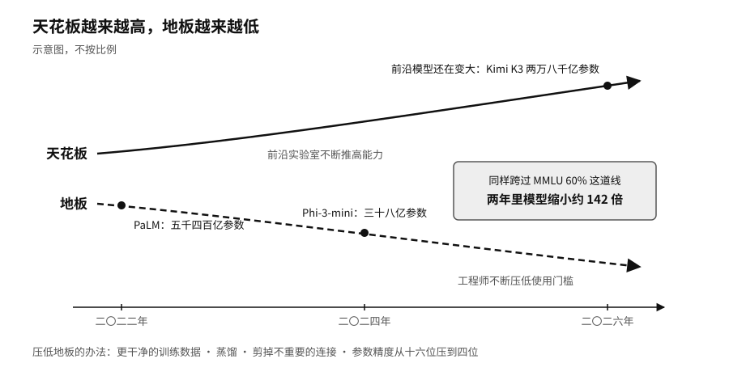

## 两极分化：前沿大模型与端侧小模型

2025年6月9日，苹果公司（Apple）把装在iPhone里的那个约30亿参数的模型开放给了所有开发者。通过新的“基础模型框架”（Foundation Models framework），应用可以直接调用这个端侧模型，不用付费，数据也不离开手机。为了塞进手机，苹果把每个参数压到了平均2比特。半个多月后，谷歌发布了面向手机等终端设备的开放权重模型Gemma 3n，较大的一档运行时只占约3GB内存，谷歌称它在用户投票的LMArena排行榜上拿到1300分以上，是第一个过这条线的百亿参数以下模型。[^p2-device-models-2025]

另一头，前沿模型还在变大。序章提到的Kimi K3有2.8万亿个参数，深度求索的V4-Pro有1.6万亿个。

这两件事并不矛盾。斯坦福的统计显示，要在MMLU（一项常用的多学科知识测试）上跨过60%这道线，2022年需要谷歌5400亿参数的PaLM，到2024年，微软38亿参数的Phi-3-mini就做到了，两年里缩小了约142倍。[^p2-two-frontiers]前沿实验室在不断推高能力的天花板，工程师则在不断压低使用的地板。一项能力一旦被证明可行，就会有人想办法用更少的资源再做一遍，靠的是更干净的训练数据、蒸馏、剪掉不重要的连接，以及把参数的精度从16位压到4位甚至更低。

模型的“大小”也不再是一个简单的数字。2026年的大模型多采用“混合专家”结构。Kimi K3内部有896组“专家”，处理每一个Token时只叫16组来干活，2.8万亿个参数里实际参与计算的约1040亿。可以把总参数想成一家公司的全部专家，把激活参数想成这次被叫进会议室的人。到会的人少，不代表会开得快：全部专家的资料都得存着，调度和通信也要花时间。[^p2-frontier-models-2026]

于是一套真正投入使用的AI系统，往往大小模型搭配着用。手机或公司内网里的小模型先做录音转写、文字识别、分类和去掉个人信息，少数难题再交给云端的大模型，金额和格式交给普通程序去核对，付款和发布这种撤不回的决定留给人。阿里巴巴的通义千问第三代（Qwen3）一口气发布了从6亿参数到2350亿参数的一整个家族，就是为了让不同的位置各有合适的模型可用。[^p2-small-model-family-2026]

能力从大模型流到小模型时，有一样东西经常丢掉：来历。瑞士的Apertus项目做了一个对照。2025年9月，苏黎世联邦理工学院（ETH Zurich）、洛桑联邦理工学院（EPFL）和瑞士国家超级计算中心（CSCS）发布了80亿和700亿参数的Apertus模型，训练语料覆盖1000多种语言。他们公开的不只是权重，还有训练和评测代码、数据处理过程和中间版本。[^p2-apertus] 2026年6月，团队又以80亿参数的模型为老师，蒸馏出几个更小的模型，每一步都有记录。[^p2-apertus-mini]

一个用户拿到Apertus的小模型，能查到它从哪个老师学来，老师用了什么数据，中间做过哪些压缩。一个用闭源模型的回答训练出来的小模型，就算本事差不多，这些问题一个也答不上来。哪天模型出了问题，或者需要按本国语言重新训练，前者的使用者知道从哪里下手。
