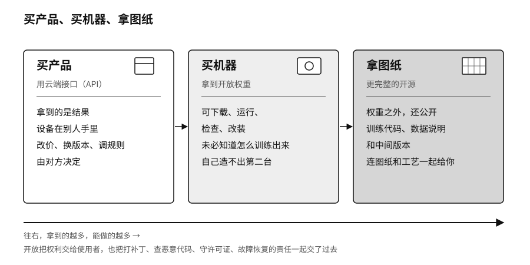

## 开源光谱：买产品、买机器、拿图纸

序章讲到的那封开放权重联名信发出三天后，英伟达又联合一批云计算、网络安全和开源机构成立了开放安全AI联盟（Open Secure AI Alliance），要一起建设用于AI安全的开放模型和工具。[^new-open-secure-alliance]

“开源”这个词在AI领域被用得很乱。两个都自称开源的模型，一个只让你调用它的接口，另一个让你下载权重、查看训练数据、修改以后再发布。把它们叫同一个名字，就像把参观工厂、买一台机器和拿到整条生产线的图纸当成一回事。

可以分三种情况来看。通过云端接口（API）用模型，好比从别人的工厂买产品，设备在别人手里，对方改价格、换版本、调整规则，你只能在合同允许的范围内应对。拿到开放权重，好比买下一台造好的机器，可以在许可范围内放在自己选的地方运行、检查和改装，但未必知道它用什么数据、怎么训练出来的。更完整的开源，还要公开训练代码、数据说明和中间版本，相当于连图纸和工艺一起给你。哪些材料给全了才算开源AI，第五章会细讲；拿到以后能做什么，要看许可证，那是第六章的话题。

开放把权利交给了使用者，也把责任一起交了过去。打补丁、检查有没有被植入恶意代码、遵守许可证、出了故障怎么恢复，这些事原来由厂商操心，现在都落到自己身上。序章说过，Kimi K3的权重谁都能下载，要跑起来却得有64张加速卡。对多数机构来说，真正的门槛是硬件、电费和一支会运维的工程队伍。

华盛顿对开放权重的态度一直在摇摆。2025年7月，白宫发布《美国AI行动计划》（America's AI Action Plan），专门列了一条“鼓励开源和开放权重AI”，理由是开放模型方便企业和研究者处理敏感数据、不必交给闭源厂商，也可能成为全球通行的标准。[^p2-us-action-plan]序章提到，一年后白宫内部又在讨论要不要限制中国的开放权重模型。权重一旦广泛发布就收不回来，原有的安全防护也更容易被去掉，这个顾虑从没消失过；美国国家电信和信息管理局（National Telecommunications and Information Administration，NTIA）2024年的报告已经把它写了进去，同时认为当时的证据不足以支持普遍限制。[^p2-ntia-open-weights]

评估先进模型对外开放的也不只是华盛顿。据科技媒体The Next Web转述的路透社2026年7月报道，中国商务部曾与几家大模型公司讨论先进模型向境外开放的问题，开放权重的下载也在讨论范围内；报道称尚未作出任何决定。[^new-china-model-export]

开放正在改变全球竞争的格局。Hugging Face 2026年春季的生态报告显示，此前一年里，这个平台约41%的模型下载来自中国模型，超过了美国模型。[^p8-hf-opensource-2026]开发者用谁的模型，就会顺着谁的格式、接口和工具往下建，用的人多了，这些东西就成了事实上的标准。

2026年8月，深度求索又开放了一样东西。它以MIT许可证（一种限制很少的开源许可证）发布了自己的智能体运行框架DeepSeek Harness，模型接口、工具登记、会话记录和智能体的工作循环全都做成可以替换的插件，连深度求索自己的模型也只是其中一个可以换掉的插件。[^p2-deepseek-harness-2026]公开的范围从训练好的模型，扩展到了组织模型干活的那套装置。
