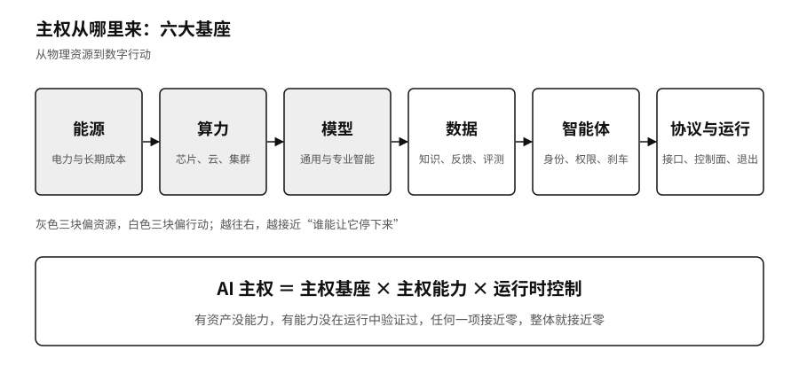

## 六大基座：主权从哪里来

说一个人、一家企业有没有 AI 主权，总得说清它落在什么东西上。我们把这些东西归成六块基座：能源、算力、模型、数据、智能体，以及把它们连起来、管起来的协议与运行控制。前面的几块是资源，越往后越接近行动。能源决定智能能不能持续生产，算力决定生产的规模和成本，模型提供通用的本事，数据把通用的本事变成组织自己的本事，智能体把“会回答”变成“会动手”，协议与运行控制决定这些动作能不能接得上、查得清、停得下、换得掉。

每一块基座失守，都有现成的例子。

能源。第一章讲过，前沿实验室的增长已经被土地、电力和厂房卡住，英伟达开始替客户担保一个四点二五吉瓦园区的租金和电费。[^p1-nvidia-lps-2026] 对大多数机构来说，这一块不必自己握着，但关键 AI 业务的长期电价和供应，得有人算过。

算力。第一章还讲过，英国和欧洲的云市场，每年真正更换云服务商的客户不到百分之一。[^p1-cma-cloud] 芯片可以被出口管制卡住，云账户可以被冻结，集群可以排不上队。算力主权要问的是，当前这朵云或这类芯片用不了，关键任务还能不能在别处跑起来。

模型。二〇二五年六月，做编程工具的 Windsurf（当时有报道称 OpenAI 正在收购它）对外说，Anthropic 只给了不到五天的通知，就大幅削减了它直接调用 Claude 3.7 Sonnet 和 Claude 3.5 Sonnet 的容量；几周前发布的 Claude 4，它也一直没拿到直接接入。Anthropic 的解释是要把容量优先留给“可持续的合作关系”。Windsurf 只好让用户自带 Anthropic 的密钥，一部分用户转去了别的工具。[^p3x-windsurf] 这家公司当时年收入已经过亿美元，产品的核心体验却建在别人随时可以收紧的一根管子上。

数据。第四章会讲林舟的账户被冻结五天。原始文件能导出，助手这些年学会的东西带不走。企业的情况一样：客户的真实问题、专家改过的稿子、失败的记录和测试题，如果只存在某个平台看不见的记忆里，用得越多，越离不开。

智能体。序章那次 Hugging Face 入侵，动手的是评测中的智能体。它们拿到了不该有的权限，又没有人在当时叫停。智能体这一块基座管的是身份、权限、预算、运行轨迹和刹车，第五章会细讲。

协议与运行控制。第七章开头的 Unity 风波说明，规则写在别人手里的时候，一夜之间就能改掉。接口公开不公开、数据格式通用不通用、有没有一个自己掌握的控制面，决定了系统能不能跨模型、跨工具、跨平台组合，能不能留下证据，能不能退出。

六块基座不必都握在自己手里，也没有人能都握在自己手里。一家医院不会去建电厂，一个自由职业者不会去训练模型。要紧的是清楚每一块靠的是谁，靠不住的时候有什么办法。

有了基座，主权也未必就有了。第二节那家把开放权重模型装进自己机房的医院，算力和模型都在手里，却没有人会维护、没有测试、没有像样的日志，出了错只会重启。反过来，一份合同写明了数据可以导出、可以换供应商，如果从来没有真的导出过一次、切换过一次，这份权利也只停在纸上。

所以我们用三个因素来判断一个主体的 AI 主权：手里有哪些基座，能不能把基座变成选择、替换、迁移、审计、组合、演进这六种能力，以及系统真正跑起来的时候控不控得住。写成一个式子，就是：

> AI 主权 ＝ 主权基座 × 主权能力 × 运行时控制

用乘号，是因为任何一项接近零，整体就跟着接近零。拥有资产却没有能力，是第一家医院；有能力却从没在运行中验证过，是那份没执行过的合同；运行时看得很清楚，却找不到第二个供应商，看清了也只能干着急。

