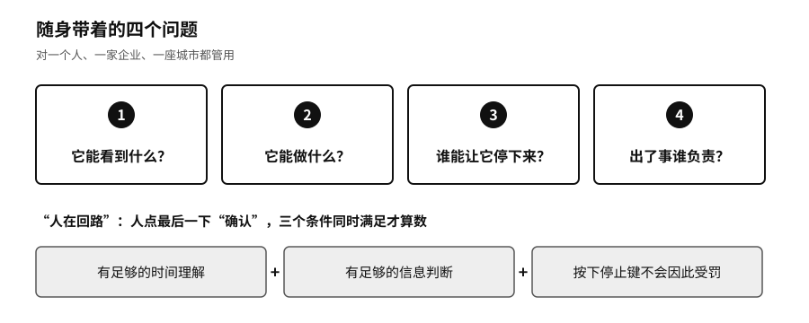

## 随身四问：主权的日常检验

六种能力是用来全面体检的。日常用的时候，我们建议记住四个问题：

- 它能看到什么？
- 它能做什么？
- 谁能让它停下来？
- 出了事谁负责？

序章从7月那几件事里提出了这四个问题。在本书里，一个人、一家企业或者一个国家能不能在系统运行时答上这四个问题，就是检验AI主权最直接的办法。它们和机器叫什么名字无关。白宫可以把AI改称SI，它能看到什么、能做什么、谁能让它停下、出了事谁负责，并不会因为换了名字就有了答案。

这四个问题对一个人管用，对一家企业、一座城市也管用。后面几章，从国家到个人，都会回到这四个问题上。

四问要在系统运行的时候问，才有意义。上线评审会上，每个问题都能答得很漂亮；真到出事那天，日志能不能调出来，停止键在谁手里，按下去以后业务怎么接着转，要靠平时演练过才知道。前面式子里的“运行时控制”，指的就是四问在运行中答得上来。

到这里，全书的框架就齐了：一个核心问题，AI动手时最终控制权在谁手里；四个日常要问的问题；六种用来体检的能力；再加上附录C讲的智能体生命周期八个环节：提示、编码、构建、测试、发布、部署、运行、再训练。书前的“全书框架”把它们画在了一页上。

“人在回路”这个说法也要拿这四个问题去检验。让人点最后一下“确认”，不代表决定就是人做的。只有在三个条件同时满足时，人的确认才算数：有足够的时间理解，有足够的信息判断，按下停止键不会因此受罚。

并不是每个人都要训练模型，每家机构都要自建数据中心。我们认为底线可以很朴素，假如你主要依赖的AI服务明天停了，至少要做到四件事。核心数据和你积累的东西，能以别处读得懂的格式带走。关键业务有一条演练过的降级路线，慢一点、多用点人，但不会停摆。系统以你的名义做过的重要事情有记录，能停下来，能追责。你的团队里仍然有人懂这件事该怎么做，看得出机器什么时候不该再做下去。

做到这四点，不能保证你永远领先，也谈不上完全独立，但一次外部变化不会让你马上失去继续做事的能力。

这些能力不会因为写进了原则就自动出现，要靠开源、许可证、数据和模型给它们打下底子。

> **行动页｜用四问和六种能力做一次主权体检**
>
> - 挑出最关键的三个AI系统，逐一回答四问：它能看到什么，能做什么，谁能叫停，出了事谁负责。答不上来的，就是第一批要补的洞。
> - 给选择、替换、迁移、审计、组合、演进各打1到5分，低于3分的进入整改清单，写明负责人和期限。
> - 对照六大基座，写下每一块靠的是谁，靠不住时的备用办法是什么。
> - 把退出演练写进年度业务连续性计划，每年至少真切换一次。
