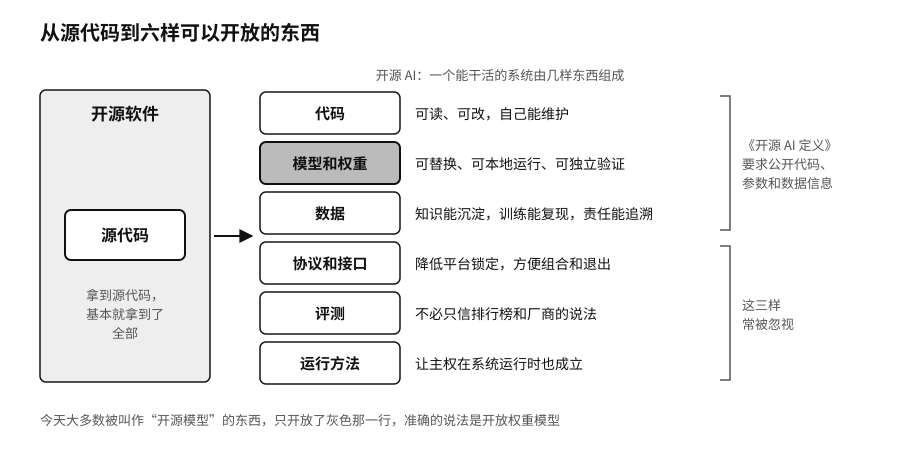

## 开源 AI：六样可以开放的东西

软件时代，一个项目最核心的东西是源代码，拿到源代码基本就拿到了全部。一个能干活的 AI 系统却由好几样东西组成：模型结构，训练好的参数（也就是权重），训练和推理的代码，训练数据以及处理数据的流程，评测方法，文档和运行环境。只公开其中一样，用户能行使的权利就差得很远。第二章用“买产品、买机器、拿图纸”区分过云端接口、开放权重和更完整的开源。

二〇二四年十月二十八日，OSI 发布了《开源 AI 定义》1.0 版。它沿用软件时代的思路，要求开源 AI 系统让使用者能自由使用、研究、修改和分享，并规定了行使这些权利必须拿到的三样东西。一是数据信息：训练数据从哪里来、范围多大、怎样挑选、怎样标注和过滤，要写得足够详细，让有能力的人能造出大体相当的系统；用了公开数据要列出来源，用了第三方数据要说明从哪里获得、要不要付费。二是代码：数据处理、训练、测试和推理的完整代码，以及模型结构。三是参数：权重，必要时还包括关键的中间检查点。[^p8-osaid] 这个定义没有要求公开全部训练数据本身，社区里为此争论不小，有人认为拿不到数据就谈不上完整复现。

按这个标准，今天大多数被叫作“开源模型”的东西，准确的说法是开放权重模型。开放权重已经很有价值：可以下载、部署在自己的机器上、做独立评测、做微调。序章里月之暗面如期公开 Kimi K3 的全部权重，Hugging Face 的安全团队用一个部署在自家服务器上的开放权重模型分析入侵记录，靠的都是这一层开放。可它不等于完整的开源 AI，用户能做什么，最后还要看许可证，这是下一章的话题。

开放的对象不止模型。我们把一个 AI 系统里可以开放的部分列在下面，每一样开放了，对主权的用处各不相同。

| 对象 | 开放意味着什么 | 对主权的主要价值 |
|---|---|---|
| 代码 | 可读、可修改、可再分发 | 减少对黑箱的依赖，自己能维护 |
| 模型和权重 | 能拿到，并按许可使用、研究、修改、部署 | 模型可替换、可本地运行、可独立验证 |
| 数据 | 来源、许可、质量、结构和使用边界清楚 | 知识能沉淀，训练能复现，责任能追溯 |
| 协议和接口 | 接口和含义公开，不同系统能互通 | 降低平台锁定，方便组合和退出 |
| 评测 | 任务、指标、基准和结果可以复核 | 不必只信排行榜和厂商的说法 |
| 运行方法 | 部署、权限、日志、回滚、迁移的做法可执行 | 让主权在系统运行时也成立 |

表里后三行常被忽视。第四章讲过协议标准怎样写进权力；评测如果只有厂商自己的分数，用户就无从判断换一个模型会好还是坏；运行方法如果只掌握在一家服务商手里，模型和数据再开放，也很难真正搬走。这一章后面讲的四层价值，最后都要落在这几样东西上。

