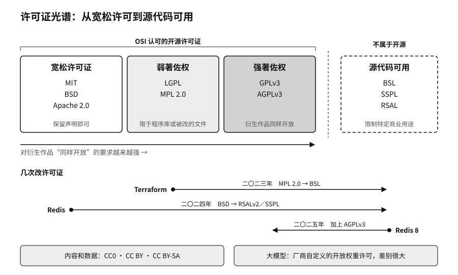

## 许可证类型：从宽松许可到著佐权

常见的开源许可证大致可以分成几类。

第一类是宽松许可证，MIT、BSD 和 Apache 2.0 是代表。它们基本只要求保留版权声明和免责声明，拿去做闭源的商业产品也可以，所以最容易被企业集成。Apache 2.0 多了几条：贡献者明确授予专利许可，修改过的文件要注明，项目里的 NOTICE 文件要随同分发。大公司发布基础组件时常选它，因为专利条款让下游用户更放心。

第二类是著佐权（copyleft）许可证，核心要求是衍生作品对外分发时，也要以同样的条件开放源代码。GPL 的要求最强，和闭源产品组合之前要仔细划清边界。LGPL 主要用于程序库，义务轻一些，但修改库本身、静态还是动态链接，义务都不一样，要具体判断。MPL 2.0 把义务限定在被修改的文件里，第八章提到的 Terraform 改许可证以前用的就是它。AGPL 再往前一步，把“通过网络向用户提供服务”也算作分发，Redis 8 加回的、MinIO 一直在用的都是它。做软件即服务的公司碰到 AGPL 尤其要留意。

第三类其实不是开源许可证，是源代码可用许可证，比如 HashiCorp 改用的 BSL、Redis 一度改用的 RSAL 和 SSPL。代码看得到，在一定范围内也能用，但限制了特定的商业用途，OSI 不承认它们是开源。

内容和数据常用知识共享（Creative Commons）系列许可。CC BY 要求署名，CC BY-SA 还要求衍生作品沿用同样的许可，CC0 则尽可能放弃权利，接近公有领域。大模型领域又多出一类厂商自定义的开放权重许可，开放程度差别很大。

| 许可证或类型 | 主要特点 | 企业通常关注什么 |
|---|---|---|
| MIT | 宽松，保留版权和许可声明即可 | 便于商业集成，义务较轻 |
| Apache 2.0 | 宽松，含明确的专利授权和 NOTICE 机制 | NOTICE 文件、修改说明、专利条款 |
| BSD 2 条款／3 条款 | 宽松，条件简洁 | 适合基础组件，保留版权和免责声明 |
| GPLv3 | 强著佐权，分发衍生作品时须开放源代码 | 和闭源产品组合前要做边界分析 |
| LGPL | 主要针对程序库的弱著佐权 | 链接方式和修改库本身的义务要具体判断 |
| AGPLv3 | 通过网络提供服务也要提供源代码 | 软件即服务和平台企业要做合规评估 |
| MPL 2.0 | 文件级著佐权 | 被修改的文件要开放，允许和其他代码大范围组合 |
| CC BY／CC BY-SA | 多用于内容和数据集，很少用于代码 | 署名、相同方式共享、数据权利、第三方内容 |
| CC0 | 尽可能放弃权利 | 隐私、人格权、数据库权等问题依然存在 |
| BSL、SSPL、RSAL 等 | 源代码可用，限制特定商业用途 | 不属于开源，要看是否构成“竞争性服务” |
| 开放权重自定义许可 | 常见于大模型，开放程度差异很大 | 商用、再分发、用户规模、用途限制、衍生模型条款 |

这张表只是一张地图。具体到一个项目，用的是哪个版本的许可证，有没有附加条款，依赖的其他组件又是什么许可证，都要逐项核对。

