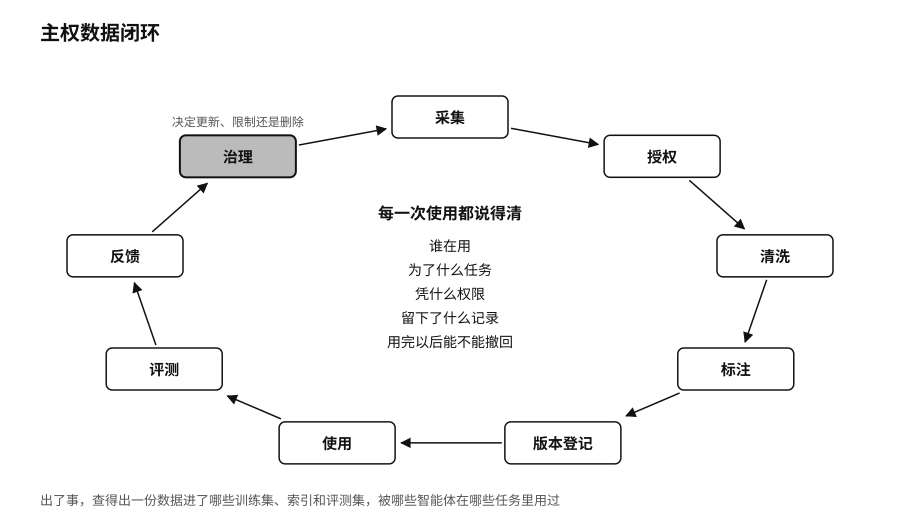

## 数据闭环：从数据湖到主权数据闭环

过去十几年，企业建数据平台的思路大多是集中：把各个系统的数据抽出来，汇进一个数据湖，再在上面做报表和分析。到了 AI 时代，这个思路很自然地延伸成第十二章讲过的“企业大脑”，把全部邮件、文档和数据库接到一个对话框后面。第十二章也讲了它的风险，并主张让问题去找数据，数据留在原处，由对它负责的部门看管，只交回完成任务所需的最少结果。

从主权的角度看，数据放在哪里没有那么要紧。数据可以集中，也可以留在原来的系统里，要紧的是每一次使用都说得清：谁在用，为了什么任务，凭什么权限，留下了什么记录，用完以后能不能撤回。我们可以把这叫作主权数据闭环。一份数据从采集开始，经过授权、清洗、标注、版本登记，进入使用和评测，产生的反馈再回到治理环节，决定它下一步该更新、限制还是删除。

这个闭环里的每一步，前面几章都碰到过。采集和授权，对应第十三章讲的个人数据要能带走；清洗和标注，对应本章前面讲的质量；版本登记，对应数据卡；使用时的身份和权限，对应第十二章讲的最小权限和行动房卡；用完以后能撤回、能退出，对应第四章讲的数据空间，共享数据而不交出控制权。

闭环的好处在出事时最明显。一份数据被发现来源有问题，或者数据主体要求删除，闭环做得好的组织可以查出它进了哪些训练集、哪些索引、哪些评测集，被哪些智能体在哪些任务里用过，然后逐一处理。闭环没做的组织，只能在全公司发通知，请大家“自查”。
