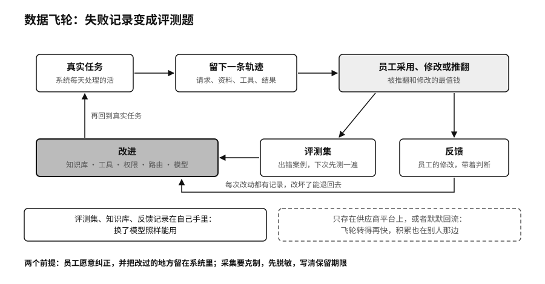

## 数据飞轮：从失败记录到评测题

企业用AI最有复利的地方，是一个能转起来的数据飞轮。

系统每处理一项真实任务，都会留下一条轨迹：收到了什么请求，查了哪些资料，调了哪些工具，给出了什么结果。有的结果被员工原样采用，有的被改了几处，有的被整个推翻。被推翻和被修改的那些最值钱。出错的案例整理进评测集，下次换模型或者改提示词时先拿它测一遍；员工的修改记下来，就是带着业务判断的反馈；这些反馈推动知识库、工具、权限、路由或者模型本身的改进，改进后的系统再回到真实任务里，产生新的轨迹。

飞轮每转一圈，企业多攒下的除了一次调用记录，还有一份别人很难复制的经验。这份经验存在企业自己手里的评测集、知识库和反馈记录里，换了模型照样能用。反过来，如果这些东西只存在供应商的平台上，或者作为“改进服务”的数据默默回流给了供应商，飞轮转得再快，积累也在别人那边。

改进也不一定意味着重新训练模型。附录C讲的AgenticOps把智能体的生命周期分成八个环节，最后一个叫再训练，它的范围比字面意思宽得多。修正任务的定义，补一段知识，换一个工具，收紧一项权限，给评测集加几道题，调整哪类请求交给哪个模型，这些都是改进，而且往往比微调模型便宜，也更容易回滚。真正需要微调或者训练领域模型的时候，前面攒下的评测集和反馈正好派上用场。每一次改动都要有记录，改坏了能退回去。

飞轮要转起来，有两个前提。一是员工愿意纠正AI，愿意把改过的地方留在系统里，不在系统外面另做一份。纠正要方便，被采纳要让人看得见。二是采集要克制。记录轨迹会碰到员工和客户的隐私，只采集改进需要的部分，敏感内容先脱敏，保留期限事先写清楚。

> **行动页｜把经验变成自己的资产**
>
> - 选一项已经在用AI的业务，把过去三个月被员工推翻或大改的输出整理出来，做成第一版评测集。
> - 为这项业务用到的每个数据集补一张数据卡，写明来源、授权、处理过程、适用范围和负责部门。
> - 检查合同和平台设置：轨迹、反馈和评测集能否完整导出，是否默认回流给供应商。
> - 给员工一个顺手的纠错入口，每月看一次纠错被采纳和转进评测集的数量。
