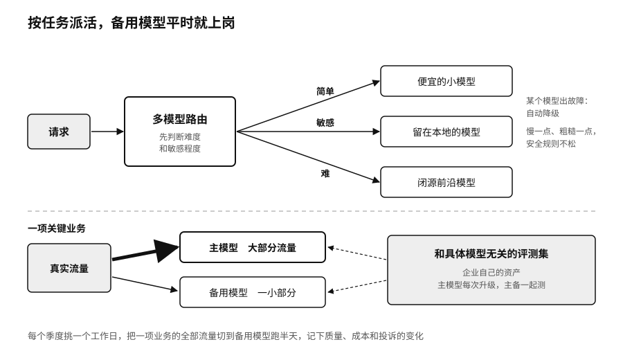

## 备用模型：关键业务的底线

模型主权有一条底线：任何关键业务，都不应该把某一个模型永远可用、永远同价、永远同样好当作架构的前提。

备用模型最常见的毛病是只存在于架构图上。平时所有流量都走主模型，备用模型只在文档里写着“必要时切换”。到了主模型下线、涨价或者被限流那天，团队才发现备用模型的提示词没调过，输出格式对不上，评测集也没跑过，切过去以后投诉一下子涨上来。

比较稳妥的做法，是让备用模型平时就承担一小部分真实流量。这样它的提示词一直有人维护，它在真实任务上的表现一直有数据，团队对切换的步骤也熟悉。主模型每次升级，用同一套评测集把主备两个模型都测一遍，差距多大、差在哪里，心里有数。这套评测集要和具体的模型无关，第七章讲过，它是企业自己的资产。

切换演练也要定期做。第十二章会讲到“七天演练”：假设最依赖的供应商停止服务七天。落到模型这一层，可以每个季度挑一个工作日，把某项业务的全部流量切到备用模型上跑半天，记下质量、成本和投诉的变化。演练结果常常比预想的好，有时也会暴露平时没注意到的依赖，比如某段提示词用了只有主模型才认的格式，某个下游程序只能解析主模型的输出。

这些做法都要花钱，备用模型的流量、评测和演练都是成本。可以把它和一次被动迁移的代价放在一起比较。本章开头那两次下线，第一次没有留过渡期，第二次提前了15天，下一次给多长时间，由厂商决定。

> **行动页｜给模型准备好替补**
>
> - 列出所有在用的模型，写明具体版本号、调用它的业务、量化和提示词版本，以及厂商公布的下线计划。
> - 为每项关键业务指定一个备用模型，平时就分给它少量真实流量。
> - 维护一套和具体模型无关的评测集，主模型每次升级都拿它同时测主备两个模型。
> - 每个季度做一次切换演练，记录切换用时、质量变化和暴露出来的隐藏依赖。
