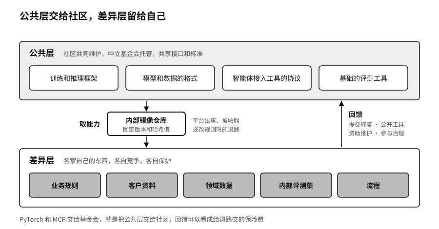

## 两层分工：公共层与差异层

如果每家企业、每座城市都从头开发自己的模型管理工具、数据工具、智能体框架和评测系统，结果只会是大量重复建设，而且每一套都没有足够的人维护。这样建起来的东西看上去完全属于自己，实际上很脆弱：维护的人一走，系统就没人懂了；外面的技术往前走了，它也跟不上。

可持续的主权需要生态托底。比较合理的分工，是把系统分成公共层和差异层。公共层是大家都需要、又没必要各做一套的部件，比如训练和推理框架、模型和数据的格式、智能体接入工具的协议、基础的评测工具。这一层由社区共同维护，共享接口和标准，做出规模。差异层是每家企业自己的业务规则、客户资料、领域数据、内部评测集和流程，这一层各自竞争，也各自保护。

PyTorch和MCP交给基金会，就是把公共层交给社区。参与的公司在公共层上放弃了一部分控制，换来的是生态的规模，以及不被任何一家对手卡住的保证。第四章讲过协议标准里写着的权力，一个由中立机构管理、多家公司共同参与的标准，比一家公司说了算的标准更难被拿来卡别人。

对城市和国家也是如此。第十一章会讲到，城市竞争已经从比算力规模转向比产业生态，模型社区解决的是开发者“拿什么开始”的问题。一座城市建了再大的机房，如果开发者找不到可以直接用的模型、数据集和工具，机房也很难转起来。
