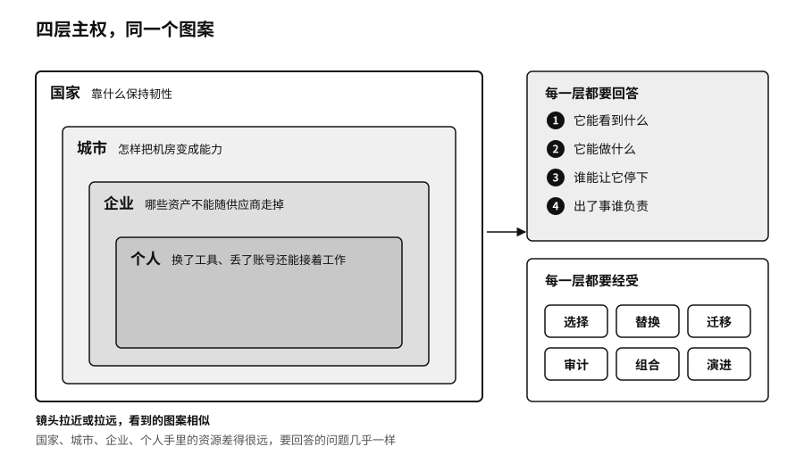

# 第三部　分层主权：国家、城市、企业与个人

主权常被当成只属于国家的大词。智能体进入现实世界以后，同一组问题会在不同的尺度上反复出现：数据归谁，谁能调用算力，谁来决定用哪个模型，谁给智能体授权，谁能让它停下，出了事谁负责。一个国家、一座城市、一家企业和一个人手里的资源差得很远，要回答的问题却几乎一样。

我们可以把这四层看成一种分形结构。把镜头拉近或拉远，看到的图案相似。每一层都要回答序章的四个问题：它能看到什么，它能做什么，谁能让它停下，出了事谁负责。每一层也都要经受第三章那六种能力的检验，也就是选择、替换、迁移、审计、组合和演进。

尺度变了，同一个问题的样子会变。国家要担心的是芯片出口许可、外国云服务的条款和本国语言在模型里的分量；城市要担心的是机房建成以后有没有人来用，公共数据怎样授权；企业要担心的是流程、知识和评测会不会跟着供应商一起走掉；个人要担心的是换了工具、丢了账号以后，自己积攒的数据和工作方法还在不在。资源越少的一层，能自己造的东西越少，越要靠开放的接口、可导出的数据和可替换的供应商来保住选择权。第二部讲的开放与退出，在这四层都用得上。

这一部按尺度从大到小排。第十章讲国家：中国、中东和东南亚走了三条不同的路，一个国家的 AI 能力由哪几块拼成，哪一块断了会全盘停下，语言和数据为什么也是主权，政府自己用算法时又该受什么约束。第十一章讲城市：一座城市怎样把机房里的算力变成本地企业天天在用的服务，用什么数字证明它做到了。第十二章讲企业：AI 原生的组织怎样给智能体授权、装刹车、算清三本账。第十三章讲个人：一人公司和超级个体怎样守住自己的数据、授权和可迁移性。
