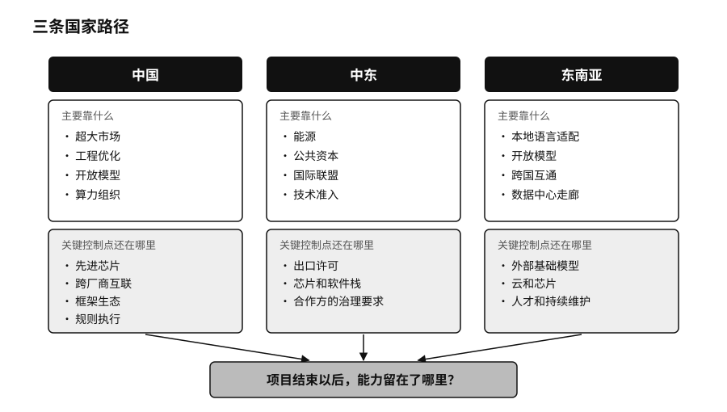
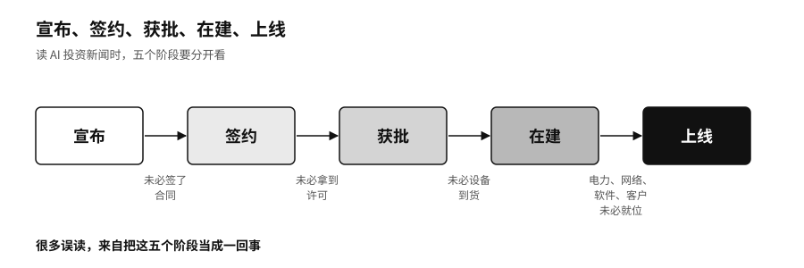

## 国家路线：中国、中东与东南亚

各国的资源禀赋不同，走的路也不一样。中国靠的是超大的市场、工程能力和开放模型；中东把能源、资本和技术准入组合在一起；东南亚更看重本地语言和跨国合作。三条路的起点不同，最后都要回答同一个问题：项目结束以后，能力留在了哪里。

### 中国：在受限的算力上

2022年到2025年，美国多次收紧先进计算芯片和半导体制造设备的出口管制，中国团队取得前沿算力的条件越来越难。[^p7-bis-compute]深度求索在DeepSeek-V3的技术报告里写明，模型是在英伟达H800芯片集群上训练的，这是英伟达为符合出口规定、专门给中国市场做的降级版本。报告披露，完整训练消耗了约278.8万个H800 GPU小时（一张芯片运行一小时记为一个GPU小时）。[^p7-deepseek-path]这个数字不包括前期探索、失败的实验和后来DeepSeek-R1的训练，它说明的是，算力不够用的时候，团队会想方设法让每一份算力产出更多能力。

这条路线也离不开全世界。V3用的是美国设计的芯片，R1的蒸馏版本建在阿里巴巴的通义千问和Meta的Llama之上，部署依赖全球的开源工具。

国产芯片在追赶。2026年4月深度求索发布V4当天，华为昇腾、寒武纪、海光、平头哥、摩尔线程、沐曦、昆仑芯和天数智芯八家国产芯片厂商宣布完成适配，发布当天就能部署。两个月后，深圳河套学院等单位的团队报告，用1000多张华为昇腾910C芯片，对1.6万亿参数的V4-Pro完成了1500多步的全参数后训练，称全程零中断。[^p7-ascend-day0]这说明生态响应快了，还不能证明长期运行已经稳定，跨厂商芯片的互联也还需要独立测试来验证。

中国的规模提供了大量学习机会。截至2025年12月，中国生成式AI用户约6.02亿，748款生成式AI服务完成了备案。[^p7-china-scale]制造、能源、医疗、金融这些行业有海量的真实任务。如果行业知识只沉淀在少数几个平台里，企业带不走自己的测试题和反馈，超大的市场也可能变成超大的锁定。

### 中东：能源、资本和准入

中东的AI新闻里，最常见的是巨额投资和数据中心容量。读这类新闻，要把宣布、签约、获批、在建、上线五个阶段分开看。星际之门·阿联酋在2025年5月是“宣布”，G42的芯片到11月才“获批”。

阿联酋的起点并不是数据中心。阿布扎比技术创新研究所（Technology Innovation Institute，TII）先后发布了Falcon（“猎鹰”）系列开放权重模型，2025年又推出了面向阿拉伯语和地方方言的Falcon Arabic。[^p7-uae-falcon]

沙特开发了阿拉伯语模型ALLAM，多数版本是在Meta的Llama 2基础上继续训练的。[^p7-saudi-allam]它的“国家属性”体现在阿拉伯语数据、政府应用入口和本地的组织能力上。2025年5月，沙特公共投资基金（Public Investment Fund，PIF）成立了HUMAIN公司，把数据中心、云、模型、应用和硬件采购集中到一家国有运营公司，随后与英伟达、AMD、亚马逊云科技、谷歌等多家企业合作。[^p7-saudi-humain]多找几家供应商，降低了对单一公司的依赖，共同的瓶颈却还在：截至2025年11月，美国商务部批准给HUMAIN的芯片，同样是相当于最多3.5万颗GB300。[^p7-gulf-export]

阿联酋和沙特都没有打算自己造每一颗芯片。它们想留在本国手里的，是模型为谁服务、数据流向哪里、算力怎么调度，让这几件事处在本国能够谈判、能够问责的范围里。

### 东南亚：把依赖关系设计好

东南亚几百种语言分布在十多个国家，全球的大模型很容易进来，本地的语言和文化却未必被认真对待。

新加坡2023年启动了7000万新元的国家多模态大模型计划，由新加坡国家人工智能计划AI Singapore开发的SEA-LION专门覆盖东南亚语言，也照顾到新加坡式英语这类英语和本地语言夹杂的说话方式，后来又在Llama、谷歌的Gemma、通义千问等开放模型的基础上继续训练。[^p7-sealion]谁收集语料、谁设计测试、谁来定义什么算错，谁就在定义这片地区的现实怎样被机器理解。印度尼西亚的Sahabat-AI覆盖了印尼语、爪哇语、巽他语、巴厘语和巴塔克语。[^p7-sea-adapt]

越南的故事提醒人们，模型留下了，团队未必留得下。2023年，越南科技公司VinAI从头训练了约37亿参数的越南语模型PhoGPT，以宽松的开源许可证公开了代码和权重。[^p7-phogpt]2025年4月，美国芯片公司高通（Qualcomm）收购了VinAI的研究和生成式AI团队，VinAI在Hugging Face上的页面随后注明不再更新。权重还在，原来那支知道怎么训练下一版的团队却已经换了东家。

东盟也没有用一个区域超级数据库来整合各国。东盟单一窗口（ASEAN Single Window）让10个成员国的海关系统按共同标准交换原产地证书和报关文件，各国保留自己的系统，只在接口上互通。[^p7-asean-rules]资源有限的国家，可以在依赖关系的设计上下功夫，把接口和退路定在自己手里。
