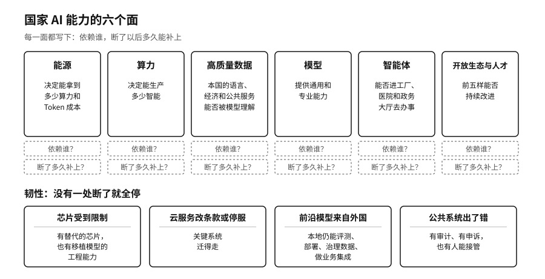

## 六个基础面：从能源到开放生态

谈国家AI主权，最常听到的两个问题是：有没有自己的大模型，有没有自己的算力中心。这两个问题都重要，只是都不完整。一个国家的AI能力，至少要从六个面来看。

第一个面是能源。第一章讲过，Token工厂最终是一座耗电的工厂，国际能源署估算全球数据中心用电会从2024年的约415太瓦时，涨到2030年的约945太瓦时。[^p1-iea-energy]能源决定了长期能拿到多少算力，也决定了每个Token的成本。第二个面是算力，它决定一个国家能生产多少智能。第三个面是高质量数据，它决定本国的经济活动、语言、文化和公共服务能不能被模型准确理解。第四个面是模型，提供通用和专业的能力。第五个面是智能体，决定这些能力能不能真正进入工厂、医院和政务大厅去办事。第六个面是开放生态和人才，决定前面五样能不能持续改进下去。

这六个面互相牵制，只盯一面，容易得出偏颇的结论。一个算力中心建好了，如果缺少数据、模型、开发者和真实任务，它只是一笔资产，第十一章会讲到不少城市在这上面吃过亏。一个模型发布了，没有企业去用、没有人维护，同样很难变成生产力。

上一节的三条路线，就是三种不同的组合。

中国2025年8月的一份国家文件，把其中几个面写进了同一张计划表。国务院印发的《国务院关于深入实施“人工智能+”行动的意见》（国发〔2025〕11号）提出，到2027年，新一代智能终端和智能体等应用的普及率超过70%，2030年超过90%。文件把数据、算力、电力和网络放在一起统筹，要求持续建设高质量数据集，并写明支持人工智能开源社区建设。[^p13-ai-plus]普及率按使用来算，要求能源、算力、数据和模型最后都落到智能体办成的事情上；怎么统计，文件没有细说。

各国不必六个面样样领先，也做不到。比较现实的目标是，每一面都清楚自己靠什么、依赖谁、断了以后多久能补上。
