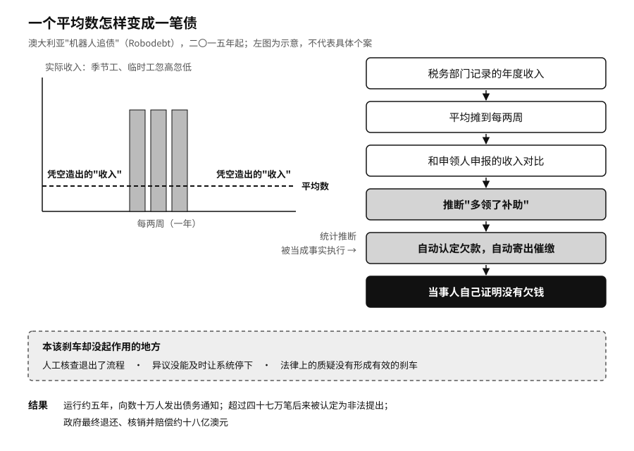

## 算法治理：机器人追债的教训

国家要防止社会受制于外部平台，也要防止公民受制于本国的机构和平台。序章的四个问题放到政府身上同样成立：它能看到关键系统里在发生什么吗，能决定模型和智能体在公共服务里做什么吗，出了问题有没有人有权让它停下，出了事故责任能不能追到人。四个问题里只要有一个答不上来，技术能力再强也会伤到自己的公民。

二〇一五年，澳大利亚政府启动了一项自动追讨福利多发款的计划。系统自动比对数据、认定欠款、寄出催缴通知。公众后来管它叫“机器人追债”（Robodebt）。

系统的做法是，把税务部门记录的年度收入和福利申领人申报的收入对比，再把年收入平均摊到每两周，据此推断某些人曾经多领了补助。对工资稳定的人，平均数也许接近实际；对季节工、临时工和收入忽高忽低的零工，平均数会凭空造出一段从未存在过的“收入”。

一个统计推断进了追债流程，就被当成事实来执行。很多人收到通知，要自己证明没有欠钱，去解释一笔连计算过程都看不懂的债务。人工核查退出了流程，异议没能让系统及时停下。

这个计划运行了约五年，向数十万人发出债务通知，其中约四十七万笔后来被政府承认为非法提出。政府在二〇二一年的和解中退还、核销并赔偿了约十八亿澳元；二〇二六年六月，法院又批准了一笔五亿四千八百五十万澳元的新和解。二〇二三年，皇家调查委员会建议政府的自动化决定要有统一的法律框架、清楚的复核途径和通俗的系统说明，算法要能接受独立审查。[^p7-robodebt]

换一个更准确的模型，未必能避免这些问题。准确率回答的是系统多常猜对。公共机构还得回答：它有没有权去猜，猜错了谁来承担，被猜错的人怎样拿回自己的权利。一个影响一百万人、准确率百分之九十九的系统，仍然可能让一万人陷入错误。

瑞典的例子更近，用的也是真正的机器学习。瑞典社会保险署（Försäkringskassan）多年来用一个模型给申领“临时育儿津贴”（父母在家照顾生病孩子期间领的补贴）的人打风险分，分数高的人会被转给反欺诈调查员，被查的人一般不知道自己是被算法挑出来的。二〇二四年十一月，调查新闻机构 Lighthouse Reports 和《瑞典日报》（Svenska Dagbladet）拿到被模型标记的数据，请学者做了公平性测试，发现女性、移民、低收入者和没上过大学的人被过多选中。社保署拒绝了几乎所有信息公开申请。二〇二五年六月，瑞典数据保护机构（IMY）立案检查；社保署回复说模型已经停用，IMY 于是在十一月结案，没有作出违法认定。[^p6-sweden-welfare]

模型停了，它几年里挑出过多少人、冤枉了多少人，社保署一直没有说明。更早一些，荷兰海牙地区法院在二〇二〇年判定，政府把多类数据拼起来筛查福利欺诈的 SyRI 系统违反了《欧洲人权公约》关于私人生活的条款。[^p7-syri] 各部门各自合法掌握的数据，一旦被拼接起来筛查，就形成了一种新的权力。

### 说明、复核和记录

一个收到不利决定的人，首先需要三个朴素的答案：依据了什么事实，哪一条规则影响了我，怎样才能让一个有权改变结果的人重新看一遍。异议要送到一个看得到原始证据、也有权推翻系统结论的人手里，让原来的程序再跑一遍不算复核。一个需要稳定网络、复杂证明和专业术语的在线申诉入口，会把老人、残障人士和少数语言群体挡在外面。

中国的法律已经写下了这一条。《个人信息保护法》第二十四条规定，自动化决策作出对个人权益有重大影响的决定时，个人有权要求说明，并有权拒绝仅通过自动化决策作出的决定。[^p7-china-governance] 正式的规则有了，执行是否一致、解释是否具体、申诉的门槛够不够低，还要看实际运行。

公共机构还得记得自己做过什么。五年以后，一个公民追问当年的资格为什么被取消，机构不能回答“那位项目负责人已经离职了”。加拿大要求相关的政府项目在投产前做算法影响评估，系统变了还要更新；[^p7-canada-aia] 英国用统一格式公开政府部门使用的算法工具，到二〇二五年五月公布了五十九份记录。[^p7-uk-atrs] 这些制度不能保证机器不出错，至少让社会知道了机器的存在。

经合组织二〇二六年调查了三十六个成员国，只有十个国家报告对政府的 AI 应用做过影响测量。[^p7-oecd-government-impact] 政府购买 AI 的速度，快过了证明这些 AI 有没有用的速度。
