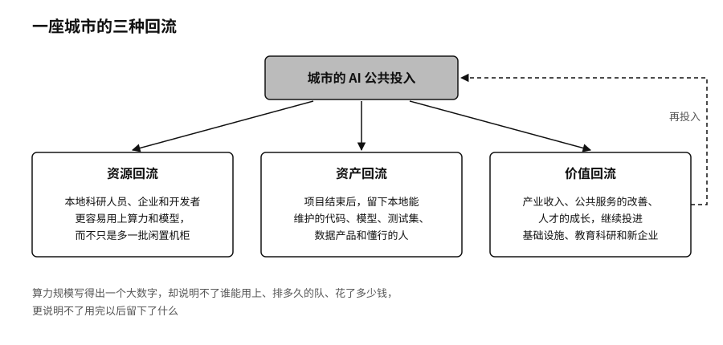

## 城市竞争：从算力规模到产业生态

城市之间的AI竞争，第一阶段比的是机柜数量、补贴力度和招商名单。这个阶段正在过去。下一阶段要看的是，开发者愿不愿意把项目留在这里，企业离开补贴以后还待不待得住。

一座城市的AI投入有没有变成能力，可以看三种回流。资源回流：公共投入有没有让本地的科研人员、企业和开发者更容易用上算力和模型，只多出一批闲置的机柜不算数。资产回流：项目结束以后，有没有留下本地能维护的代码、模型、测试集、数据产品和懂行的人。价值回流：产业收入、公共服务的改善和人才的成长，有没有继续投进基础设施、教育科研和新的企业里。

算力最容易被写成一个大数字，却说明不了谁能用上、要排多久的队、用完以后留下了什么。一些城市开始换一种做法。上海2026年的“模塑申城”补贴把投入拆成三种票券：算力券补贴企业租用智能算力，模型券补贴调用第三方模型或私有化部署，语料券补贴购买高质量训练语料。[^p8-shanghai-vouchers]开发者手里常常同时缺好几样东西：能调用的模型、合法的语料，以及完成一次迭代所需的一笔组合预算，一张算力卡只是其中一样。武汉2026年针对一人公司的措施更具体：符合条件的一人公司可以获得算力费用50%、最高20万元的补助，各区的一人公司社区每年还要给每家提供不少于2000卡时的免费算力。[^p8-wuhan-opc-compute]这些都是政策承诺，算不上效果证明。可以用它们检验的问题是：公共算力能不能让原本进不了市场的小团队，完成第一个真实任务。

机房解决的是在哪里算，模型社区解决的是拿什么开始：找模型、确认许可证、准备数据、做测试、部署上线。阿里巴巴的模型社区魔搭把模型、数据集和工具放在同一套接口下，据报道截至2026年3月已服务约2500万开发者。[^p8-modelscope-ecosystem]城市很难靠行政命令再造一个这样规模的社区，也不应该把公共的模型、算力和场景全部锁进一家平台。城市能做的，是让本地的资产和接口同时向多个社区开放，任何一家平台改了政策，都不至于把城市的生态连根拔起。
