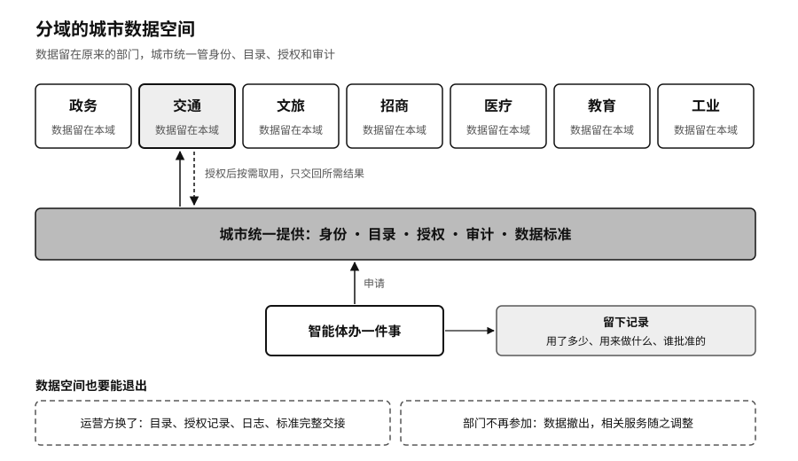

## 城市数据空间：让问题去找数据

一座城市手里有大量公共数据和产业数据。为了AI，把这些数据全部集中到一个地方，看起来最省事，也最危险。一处被攻破，处处泄露；一个部门的数据被拿去做另一件事，事后也说不清是谁批准的。

第十章讲过荷兰的SyRI系统。各部门各自合法掌握的数据，被拼到一起去筛查福利欺诈风险，海牙地区法院认定相关立法侵犯了私人生活。[^p7-syri]数据拼在一起，本身就形成了一种新的权力。一座城市要建所谓无所不知的“城市大脑”，同样会碰到这个问题。第十二章讲企业大脑时说过，统一入口能进所有系统，混进来的一段恶意文字也能顺着它走遍全公司，放到城市只会更严重。

### 分域的数据空间

比较稳妥的做法是分域。政务、交通、医疗、教育、工业各个领域守住自己的责任边界，数据留在原来的部门和机构里；城市统一提供的是身份、目录、授权、审计和数据标准。一个智能体要办一件事，按需要到对应的领域申请数据，用多少、用来做什么、谁批准的，都留下记录。这和第十二章说的“让问题去找数据，数据留在原处”是同一个思路，第四章讲的欧盟数据空间也是这样设计的。

中国的政策正在往这个方向走。国家数据局2024年11月发布《可信数据空间发展行动计划（2024—2028年）》，提出到2028年建成100个以上可信数据空间，城市是其中一类。[^p14-trusted-data-space]2025年7月，国家数据局公布首批63个可信数据空间创新发展试点，其中城市类13个，上海、厦门、贵州等地的数据集团在列。[^p14-data-space-pilots]这些试点起步不久，能不能做到数据不出域、授权可追溯，要看以后的运行记录。

### 数据空间也要能退出

城市数据空间常常交给一家国有数据集团或者一家技术公司来运营。第十章讲过，《中共中央办公厅 国务院办公厅关于加快公共数据资源开发利用的意见》要求授权运营事先约定期限和退出机制。[^p13-public-data]落到城市，就是运营方换了，目录、授权记录、审计日志和数据标准要能完整交给下一家；某个部门不想再参加，它的数据能撤出来。一个只能由某一家公司运营的数据空间，等于把城市大脑的单点换了一个地方。

对企业也一样。重庆的工厂要看到数据留在厂里、模型过来学习、用完能查到记录，才可能拿出真数据。
