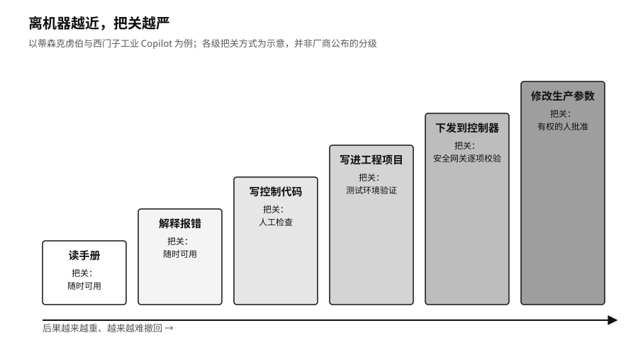

## 渐进授权：摩根士丹利的草稿策略

摩根士丹利（Morgan Stanley，美国大型投资银行）是较早在财富管理业务里使用生成式AI的大银行。它选的起点很保守。

2023年推出的第一个工具，只帮理财顾问在公司内部的研究资料里找答案，不碰交易，也不直接跟客户说话。2024年推出的会议纪要工具Debrief往前走了一步，处理客户会议记录。客户点头同意后，系统才开始整理笔记、待办事项和邮件草稿。邮件写好了，要由持牌顾问修改，发不发也由顾问决定。[^p6-morgan-stanley]

底层模型来自OpenAI。摩根士丹利在自己手里留下的，是另外一些东西：这个工具能用在哪些场合，读哪些资料，上线前怎么测，客户有没有同意，邮件最后由谁按下发送。美国金融业监管局（Financial Industry Regulatory Authority，FINRA，美国券商行业的自律监管机构）后来也专门提醒，券商用第三方的生成式AI同样要遵守现有规则，上线前先评估，管住模型的可靠性和准确性。[^p6-finra-genai]

这家银行并非不知道模型可以做得更多。它让AI停在草稿这一步，是因为再往前走，就需要更多的证据和更可靠的刹车，而这些它还没有准备好。

工厂里的做法又不一样。2024年，蒂森克虏伯（thyssenkrupp，德国工业集团）和西门子（Siemens）合作，把工业Copilot（西门子与微软合作开发的工业AI助手）用在电动车电池的质检设备上，帮工程师更快写出设备控制器（可编程逻辑控制器，PLC）的控制代码。在西门子自己的埃尔朗根电子工厂，焊锡设备报错时，它能把报错代码翻译成大白话，并给出处理建议。[^p6-industrial-copilot]

模型写的代码不会直接进机器。西门子在模型和设备控制器之间加了一道关口，代码要先按机器状态、安全联锁、操作员权限和工厂规则逐项过一遍。模型更新了，要先在虚拟环境里调试，再新旧两套并行、逐步切换上线。读手册、解释报错、写代码、下发到控制器、修改生产参数，后果一个比一个重，工厂给每一步配的门也一道比一道窄。

