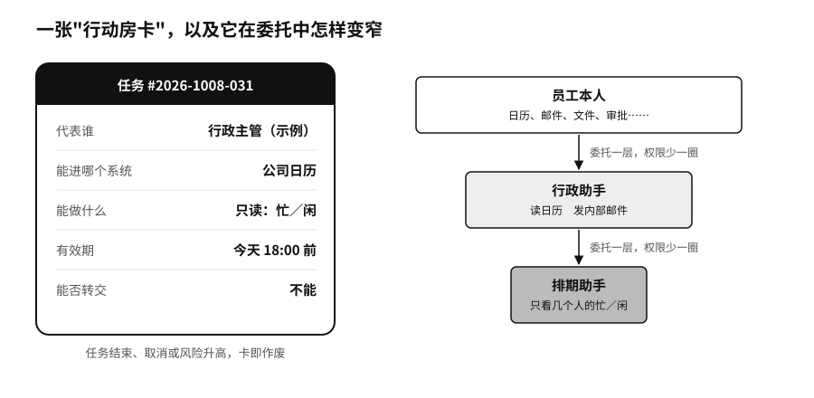
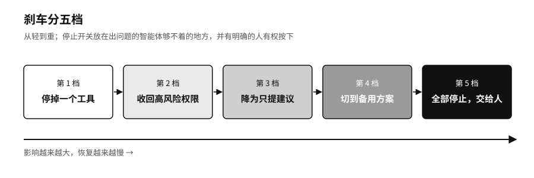

## 最小权限：行动房卡与刹车机制

数据管住了，还要管机器能动手做什么。

最常见也最危险的做法，是把员工自己的账号，甚至公司级的管理密钥，直接交给智能体，智能体再转手交给下一个。出了事查日志，只能看到“某员工账号执行了操作”，是员工本人、子智能体还是一段藏在邮件里的恶意指令触发的，说不清楚。

酒店的房卡是个好参照。订了房的客人拿不到整栋楼的总钥匙，房卡只开指定的那间房，退房当天就失效。智能体每接一项任务，也可以领这样一张卡，卡上写明它代表谁、能进哪个系统、能做哪些操作、有效期到哪天、能不能转交给别人。任务做完、被取消或者风险升高，卡就作废。

任务往下派一层，卡上的权限就应该少一些。行政助手可以读负责人的日程、给同事发邮件，它把“找一个大家都有空的时间”交给排期助手。排期助手只需要知道几个人在某几天忙不忙，会议标题它不必看，发邮件的权限更不该带过去。

技术标准已经开始这样写。截至2026年8月，第二章提到的模型上下文协议（MCP）的授权规范明确规定，不能把客户端拿到的令牌（证明身份和权限的一串临时凭证）原样转交给下游服务。[^p9-mcp-control]美国国家标准与技术研究院（NIST）下属的国家网络安全卓越中心也在2026年2月发布概念文件，就智能体的身份认证、最小权限和“代表他人办事”的授权委托公开征求意见。[^p4-nist-agent-id]

光有房卡还不够，还得有一张任务单：做到什么程度算完，由谁验收；能用哪些资料和工具，金额和次数上限是多少；遇到规则冲突、预算用完或者要做一件撤不回来的事情时，停下来找谁。任务单不规定每一步怎么走，只规定不能越过的线。智能体可以比较十条出差路线，付款却有上限；它可以标出一笔可疑交易，冻结客户账户要等人来决定。

房卡管的是有没有资格，管不了做得对不对。一张最多只能付1000元的卡，照样可能付给错误的收款人。所以刹车要在上线以前装好。我们建议立项时先写一页失败说明：这件事最不能出的错是什么，一次出错最多会波及多少人，哪些资料绝不能交给模型，哪些操作必须有人复核，外部服务断了业务能撑多久。上线也可以分几步，先拿历史任务离线试，再让它在真实流程旁边只看不动手，然后放一小部分低风险的业务给它。每多给一项权限，就多要一份测试证据。

真出了错，先停下来，别急着重试。提交订单时超时，智能体不知道订单是没建成还是回执丢了，再提交一次可能就重复下单。刹车最好分几档：先停掉一个工具，再收回高风险的权限，再把它降成只能提建议，再切到备用方案，最后整个停掉、交给人处理。停止开关要放在出问题的智能体够不着的地方，而且要有一个确实有权按下它的人。如果员工在屏幕上只看得到“风险分78”，看不到原始材料，或者他可以表示反对，却改变不了任何结果，所谓“有人把关”，只是把责任推给了这个人。

做模型的公司自己也不敢在这件事上打包票。2026年10月5日，纽约市议会全体议员就AI风险举行听证，OpenAI、Anthropic、谷歌和Meta的代表到场。议长要求他们保证自家的智能体始终遵守安全防护，四家都没有给出保证。议长办公室提出的约十项法案里，有一项就是要求配备由人掌握的停止开关。[^new-nyc-hearing]
