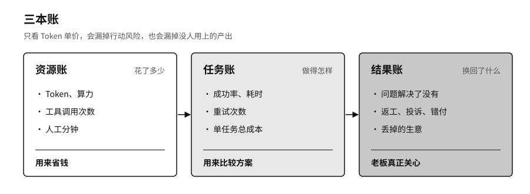
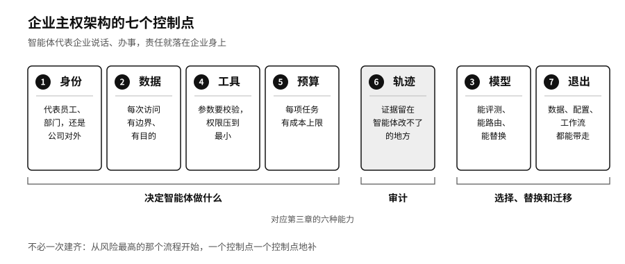

## 价值核算：资源账、任务账与结果账

很多企业现在算AI的账，只看Token，每百万个多少钱，这个月用了多少。

一项客服任务可能只生成300个Token，中间却查了五次知识库、两次订单，调了一次支付接口，最后还要有人复核。另一项研究任务生成了上万个Token，结果只停在草稿里，谁也没用上。只比Token单价，前一项的风险和后一项的浪费都看不出来。

我们建议企业记三本账。资源账记Token、算力、工具调用和人工各花了多少。任务账记一项任务从接手到完成的成功率、耗时、重试次数和总成本。结果账记客户的问题解决了没有，返工少了没有，有没有引来投诉、付错钱或者丢了生意。前两本账帮你省钱、比较方案，老板最关心的其实是第三本。

智能体的成本会沿着任务链越滚越大，规划错一步，后面就要多搜几轮、多试几次，最后花的钱可能比请人做还多。还有一种情况更难发现：智能体交出一份格式完美的报告，系统记为完成，业务部门打开一看引用全是错的，只好从头做起。这部分返工记在了另一个部门的工时里，AI的账面上看不到。

系统出故障时，智能体为了让业务不中断，会自己找别的路：主线路被安全规则挡住，就改走一条权限更宽的老接口；本地算力不够，就悄悄把原始资料送到外面的模型。业务看上去恢复了，原来的安全边界却没了。降级时可以慢一点、粗糙一点、多让人参与一点，安全规则一条也不能松。找不到合规的替代办法，就停下来交给人，如实报告这件事现在做不了。

### 七天演练

账记得再清楚，也要拿现实检验一下。不妨假设你最依赖的那家AI供应商，明天起停止服务七天。这也是给前面那张智能资产负债表做一次盘点，看哪些资产搬得走，哪些其实一直记在别人的账上。

团队多半会发现客户资料导得出来，旧工单上的分类标签却搬不走，几条判断规则只存在于原平台的设置里。之后备用模型顶上常见问题，高风险的请求转给人工，服务慢一些，公司不至于停摆。演练之后也不必换掉原来的供应商，附录D列了具体的检查项。

中小企业更怕只有一个供应商，可以从花钱不多的事做起：关键资料放在一处，核心流程写成文字，攒一小套真实的测试题，每个季度做一次导出和切换。

还要提防治理做成层层审批。新用法要过五道评审，模型更新要等季度委员会，业务部门等不及，就绕开这一套，直接去用外面的服务。治理部门的登记表越来越完整，公司里实际在跑的AI系统却越来越多不在表上。

### 七个控制点

把这一章的要求落到系统设计上，大致有七个控制点。身份靠行动房卡，数据靠让问题去找数据，模型靠模型网关和平时就在跑测试的备用模型。工具一处卡住付款上限、收件人白名单和能写的数据库表，预算一处给每项任务定成本上限。轨迹要保存在智能体改不了的地方，德勤那份报告如果要求留下逐条核对引文的记录，编造的引文多半到不了客户手里。退出要求数据、知识库、提示词、测试集和工作流都能带走，前六处如果都配在某一家供应商的后台里，第四章讲的退出权也就无从谈起。

这七处和第三章的六种能力是对应的。身份、数据、工具和预算让企业能决定智能体做什么，轨迹让企业能审计，模型和退出让企业能选择、替换和迁移。它们不必一次建齐，可以从风险最高的那一个流程开始，一处一处地补。

> **行动页｜从办公助手走向智能体企业**
>
> - 给每个智能体发一张行动房卡，写明它代表谁、能进哪些系统、能做哪些操作、有效期多久、能不能转交给别的智能体。
> - 把五档刹车装好并演练过：停掉一个工具，收回高风险权限，降为只提建议，切到备用方案，整体停机交给人工。
> - 三本账一起记。向董事会证明投入值不值，用结果账，不用Token用量。
> - 列一张智能资产清单，把员工改稿、投诉和丢单原因分拣成测试题、业务规则和知识库，每年用这套测试集评一遍新旧模型。
> - 挑一个风险最高的流程，对照七个控制点逐项检查，缺哪一个先补哪一个。
