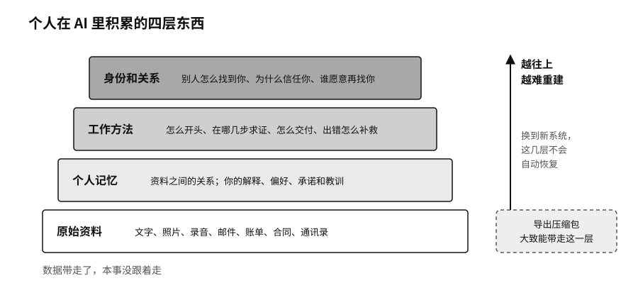

## 数字连续性：带得走的四层资产

把一个AI账户里的数据完整导出来，通常并不难。压缩包里有几千段对话、附件和时间戳，一份不少。可把这些材料放进另一套系统，原来的工作并不会自动恢复。新系统不知道哪些是长期的偏好，哪些事已经办完，哪些结论后来被推翻了。数据带走了，本事没有跟着走。

AI偶尔答错一次，人还能发现、能纠正；更难察觉的，是长期的记忆、联系人、作品、工作流程和身份，一点点锁进了少数几个账户，账号受限或者服务关停，几年的积累可能一夜丢掉。我们把一个人在换了工具、丢了账号以后，还能接着工作、接着做自己的能力，叫作数字连续性。

一个人在AI里积累的东西，大致分四层。最底下是原始资料：文字、照片、录音、邮件、账单、合同、通讯录。往上一层是个人记忆，也就是这些资料之间的关系，以及你自己的解释、偏好、承诺和教训。再往上是工作方法，一件事怎么开头、在哪几步要求证、怎么交付、出了错怎么补救。最难重建的是最上面一层，身份和关系：别人怎么找到你，为什么信任你，哪些客户愿意再找你。

四层全都放进同一个产品里，用起来非常顺手，代价是哪天要离开，你得把自己重新教一遍。

每一层都有带走的办法。原始资料要用通用格式另存一份，放在主要服务商够不着的地方。Meta封号的那些人里，手里另有一份离线备份的，丢掉的只是一个账户。个人记忆要写成自己看得懂的笔记：哪个客户周五不能打扰，哪一版报价已经作废，某个项目最后的结论是什么，这些不能只存在助手的“记忆”功能里，平台的隐藏记忆很难完整导出。工作方法最容易被忽略，常用的提示词、搭好的工作流程和工具设置，换平台时才发现带不走。最好再写一页“我怎样工作”的任务说明，换一个助手或者请一位临时帮忙的人，看完就能上手。

身份和关系最难打包。客户为什么信任你，合作者为什么愿意再找你，这些不在任何文件里。前三层保管好了，关系断掉的时候，至少还有重建的材料。
