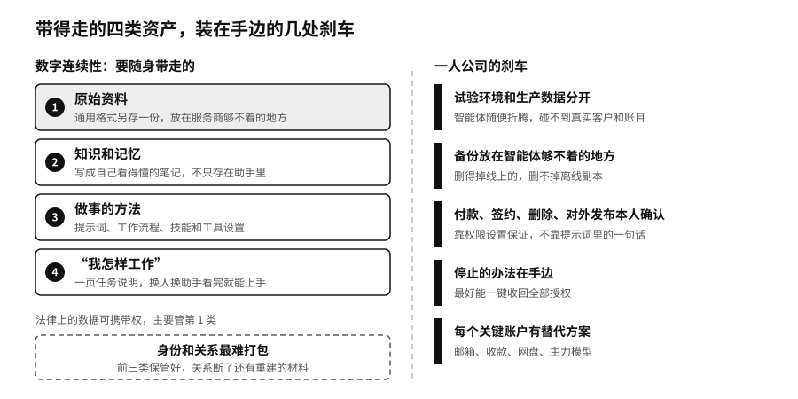

## 一人公司：杠杆越大越要能刹车

一家公司为什么需要那么多人？近一个世纪前，经济学家罗纳德·科斯（Ronald Coase）用交易成本来解释：找合作方、说清需求、谈价格、签合同、检查结果、解决纠纷，都要花成本，当这些成本比在公司内部协调更高时，事情就会被收进公司里来做。[^p4-opc-mechanism]AI正在改写这张成本表。

现在，一个人可以让AI整理访谈，让智能体维护选题，让自动化工具开发票，再请律师复核合同。英文里有个说法叫OPC（One-Person Company，一人公司），说的是一个最终负责的人，指挥几个权限有限的机器角色，必要时再连接会计、律师这样的真人网络，法律上未必是一人有限公司。找资料、写代码、跟进客户都可以交给智能体；账户、付款、合同和撤不回的决定，必须有一个明确的人签字。

AI对个人生产率的影响并不整齐。一项覆盖三家企业、4867名开发者的随机研究发现，用代码助手的那组平均多完成了26%的任务；另一项研究让16名熟悉大型开源项目的资深开发者完成246项真实任务，用了AI反而多花了19%的时间。[^p4-work-evidence]用了AI能不能提高效率，要看谁在用、做什么、错了由谁兜底。

微型经营主体本来就很多。2023年美国没有雇员的经营单位超过3000万个，约占全部经营单位的78%；美国支付公司Stripe旗下的创业服务平台Stripe Atlas帮助新注册的公司里，到2026年第二季度只有一位创始人的占到63%，创下新高。[^p4-opc-signal]单人创业在增加，还不能证明一人公司已经普遍成功。

### 一个停不下来的助手

一人公司越能调用外部能力，就越依赖少数几个账户和平台。传统公司有天然的冗余，一人公司没有，任何一个账户都可能成为单点故障。布西赫梅德的店铺账户被封，五年攒下的5000多位关注者一下子联系不上了；一家一人公司丢掉主账户，可能同时断了销售、交付和收款。

机器本身也会失控。2026年2月，在Meta公司从事AI安全研究的萨默·岳（Summer Yue）在社交媒体上讲了自己的一次遭遇。她在一台苹果Mac mini电脑上运行开源的个人智能体OpenClaw（可以装在自己电脑上、接管邮箱和文件等日常事务的智能体），让它建议哪些邮件可以归档或删除，并明确说“我说了再动手”。测试邮箱里一切正常，换到真实的邮箱以后，邮件太多，智能体压缩上下文时把她那条“先别动手”的指令弄丢了，开始飞快地删邮件。她在手机上反复叫它停下，它不理会，她只好跑到那台Mac mini前面去把它停掉。[^p16-openclaw-inbox]

在自己的设备上运行开源智能体，看起来是最“有主权”的配置。可是授权写在一句会被压缩掉的提示词里，真正能让它停下来的只有那台电脑的电源。第十二章说停止开关要放在出问题的智能体够不着的地方，个人也一样。

### 刹车装在哪里

智能体能调动的东西越多，一次误操作波及的范围就越大。生产数据和试验环境分开，智能体在试验环境里随便折腾，碰不到真实的客户资料和账目。备份放在它够不着的地方。付款、签约、删除和对外发布一律保留本人确认，而且确认要靠权限设置来保证，不能只靠提示词里的一句话。停止的办法要在手边，最好能一键收回全部授权。每个关键账户都想好替代方案，主邮箱、收款平台或主力模型断了，用什么接上。

可以在一张纸上画三张小图：资料图看各类资料在哪里、哪些工具能读到；行动图看哪些助手只能提建议，哪些能发送、付款或删除；替代图看某个账户失效以后哪些角色会一起停。画下来，问题往往一目了然：研究助手为什么能看到付款资料？早就不用的测试助手为什么还有网盘权限？这是第十二章那七个控制点的个人版，一张纸写得下。

一人公司还缺一样东西：反对的声音。大公司里，重大决定会经过几个人讨论；一个人的公司没有天然的反对者，AI又往往顺着提问者的方向说。可以让一个助手专门找支持的证据，另一个专门找失败的条件，最后由自己比较。几个AI角色可能有同样的盲点，它们的用处是让人慢一点下结论。

还有一个问题：什么时候该招一个真人。责任和关系不能像算力一样自动扩展，客户遇到危机时需要一个了解来龙去脉的人，用户多了，安全和合规不能只靠创始人深夜抽查。有时候，再加一个智能体不如请一位真实的伙伴，互相检查，互为替补。

> **行动页｜让一人公司的杠杆可持续**
>
> - 把最重要的原始资料用通用格式另存一份，放在主要服务商够不着的地方，每季度更新一次。
> - 把客户禁忌、报价规则、常用提示词和工作流程写成文字，再写一页“我怎样工作”的任务说明。
> - 每个智能体只给完成任务所需的最小权限，只在试验环境里自由操作；付款、签约、删除和对外发布，靠权限设置保留本人确认。
> - 给邮箱、收款、网盘和主力模型各想好替代方案，断了以后用什么接上。
> - 每个季度挑一项最重要的工作，做一次周末测试，记下恢复要多久。
