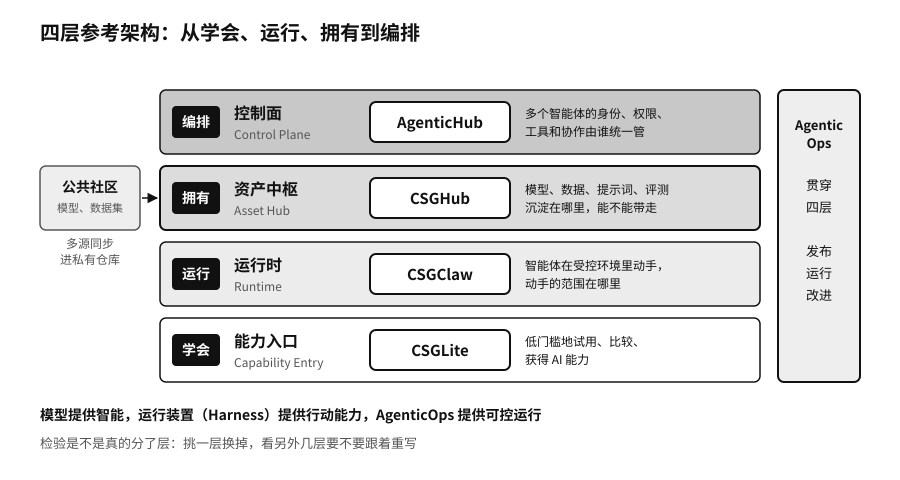

## 参考架构：从能力获得到运行时主权

四个产品放在一起，可以画成一个四层的参考架构。我们画它，是想给读者一个检查自己系统的框子，读者不必非用 OpenCSG 的产品去填。

| 层 | 英文叫法 | OpenCSG 的参考产品 | 这一层要回答的问题 |
|---|---|---|---|
| 能力入口 | Capability Entry | CSGLite | 个人和团队能不能低门槛地试用、比较、获得 AI 能力 |
| 运行时 | Runtime | CSGClaw | 智能体在个人设备和受控环境里怎样真正动手，动手的范围在哪里 |
| 资产中枢 | Asset Hub | CSGHub | 模型、数据、代码、提示词、知识和评测集沉淀在哪里，能不能带走 |
| 控制面 | Control Plane | AgenticHub | 多个智能体的身份、权限、工具和协作由谁统一管理 |

这四层也可以按一个人或一个组织用 AI 的先后顺序来读：先在本地试一试，弄懂它能做什么；再让它在受控的环境里替自己干活；干得多了，把积累下来的模型、数据和流程收进自己的仓库；最后用一个控制面去调度一群智能体。OpenCSG 自己的概括是从学会、运行、拥有到编排。AgenticOps 不单独占一层，它贯穿四层，管每一层的发布、运行和改进。

### 智能体操作系统

传统的操作系统管 CPU、内存、存储和进程，决定哪个程序什么时候能用多少资源，哪个程序不许碰哪块内存。智能体多起来以后，组织需要一个管同类问题的运行层，只是被管的对象换了：模型、上下文、记忆、工具、身份、权限、任务和智能体本身。哪个智能体这一轮能看到哪些资料，能调用哪个工具，代表谁去办事，任务失败了从哪一步恢复，都要有地方登记、有规则约束。

OpenCSG 把这个运行层叫作智能体操作系统（Agentic Operating System）。它装在 Windows、Linux 或者云平台之上，不取代它们。这个说法目前还是一个设计上的比喻，业界没有统一标准，各家的实现也差得很远。

### 三句区分

OpenCSG 常用三句话区分这几层的分工：模型提供智能，运行装置（Harness）提供行动能力，AgenticOps 提供可控运行。

第一句好理解，模型负责读懂任务、生成下一步。第二句里的运行装置，附录C专门讲过，它在模型外面维持“观察、判断、调用工具、拿到结果、继续或停止”的循环。二〇二六年八月，深度求索以 MIT 许可证开源了自己的智能体运行框架 DeepSeek Harness，官方的说法是“模型加 Harness 等于 Agent”。[^p4-deepseek-harness-2026] 第二章讲到这件事时说，公开的范围已经从训练好的模型扩展到了组织模型干活的那套装置。第三句说的是，有了智能和行动能力还不够，行动要有边界、有记录、能叫停，出了错能复盘和改进。

把三层分开说，好处是出了问题知道该去哪一层找原因。模型理解错了任务，可以换模型或改提示词；工具被调错了，要查运行装置的校验；权限给宽了，要改控制面的授权。三层也可以分别更换。检验一套架构是不是真的分了层，最直接的办法就是挑一层换掉，看另外几层要不要跟着重写。

> **行动页｜给自己的 AI 系统画一张四层图**
>
> - 按能力入口、运行时、资产中枢、控制面四层，写下你现在用的每一样工具或服务，空着的层就是缺口。
> - 对每一层，写下它的许可证或合同条款：服务停了，代码和数据还能不能留在你手里。
> - 挑一层做一次替换试验，比如把本地推理工具或模型网关换成另一家的，记录上下几层改了多少东西。
> - 公共社区里下载的每个模型，登记它的来源、版本和许可证，再决定要不要同步进私有仓库。
