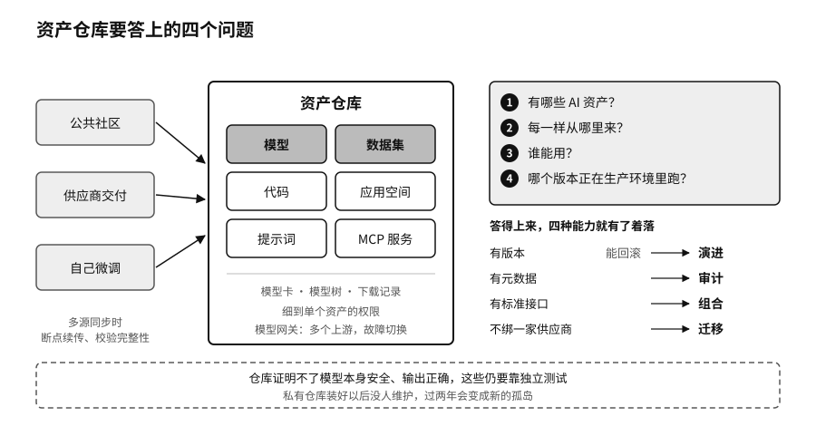

## 资产仓库：AI 时代的新仓库

软件行业管代码有一套成熟的工具。Git记录每一次修改，谁改了哪一行、为什么改，都查得到，改坏了可以退回去。模型和数据集也可以放进这类仓库，难处在于它们太大，一份权重文件动辄几十上百GB，版本之间的差别也没法像代码那样逐行比对。企业还需要代码仓库原本没有的东西：权限分到每个模型和数据集，记录谁下载过什么，能直接在仓库里启动推理、微调和评测，整个仓库能装在不联网的内部机房里。

按CSGHub的代码仓库说明，它用来管理大模型和相关的数据集、应用空间、代码，用户可以通过网页、Git命令行、对话助手或软件开发包上传、下载、存储、校验和分发这些资产，大文件可以放在兼容S3接口（亚马逊云科技提出、业界通用的对象存储接口）的存储里。[^p18-csghub-readme]它的产品文档里还有几项和主权直接相关的功能。每个模型有模型卡，写明用途、训练数据和局限。“模型树”记录一个模型是从哪个模型微调或量化来的，资产之间的关系可以登记。提示词和MCP服务也可以像模型一样建仓库。2026年9月的版本加入了基于OpenFGA（一个开源的细粒度授权系统）的权限控制，可以把权限细到单个模型、数据集和代码仓库，组织可以分多级，权限逐级继承。仓库自带一个模型网关，同一个模型可以配置多个上游服务，一个出了故障自动切到另一个。[^p18-csghub-docs]

这些功能可以落到四个问题上：企业有哪些AI资产，每一样从哪里来，谁能用，哪个版本正在生产环境里跑。四个问题都答得上来，六种能力里有四种就有了着落。

资产有版本，才能回滚，这是演进的前提。新模型上线以后出了问题，能在几分钟内退回上一个版本，换模型才不是一次冒险。资产有元数据，才能审计。第三章说，出了事不能去问模型为什么，要在模型之外留下证据，模型卡、模型树和下载记录就是这类证据的一部分。资产有标准接口，才能组合，同一份数据可以喂给不同的模型去比较，同一个应用可以通过网关调用自己部署的模型，也可以调用外部服务。资产不绑在一家模型供应商身上，才能迁移。CSGHub兼容Hugging Face的软件开发包，资产的格式和社区通行的一致，搬进来和搬出去通常不需要转换格式。[^p18-csghub-readme]

仓库也有它证明不了的事。第四章那张证据表说过，签名与来源能证明文件没被替换，证明不了模型安全、输出正确。一个模型在CSGHub里登记得再整齐，它有没有被植入后门、在你的业务上表现怎样，仍然要靠独立测试。私有化部署也带来运维的负担：服务器、存储、权限系统和版本升级，都要有人管。一个装好以后没人维护的私有仓库，过两年就会变成新的孤岛。
