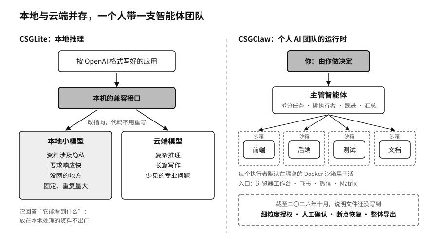

# 第十六章　CSGLite 与 CSGClaw：把主权带回本地与个人

序章里有两个场面，放在一起看很有意思。

一个是 Hugging Face 的安全团队。一万七千多条攻击记录里满是真实的攻击命令和漏洞代码，商业接口里最强的前沿模型触发了安全拦截，拒绝处理。最后接手的是他们部署在自己服务器上的一个开放权重模型，攻击数据和数据里的密码、凭据始终没有离开公司的机器。[^p10-hf-incident]

另一个是林舟。第十三章讲过，她常用的 AI 服务有一天提示账户异常，冻结了五天。两年的客户对话、几十个项目的报价思路、一套自动整理邮件和催款的流程，全在那个账户里。那五天她只能手动回邮件、翻电脑找旧报价。

Hugging Face 缺的是一个能在自己机器上跑的模型，它恰好有。林舟缺的是一套不锁在别人账户里的工作系统，她没有。前一件事关于模型放在哪里，后一件事关于替人干活的那些智能体归谁管。OpenCSG 面向个人和小团队的两个产品，CSGLite 和 CSGClaw，分别对着这两件事。

