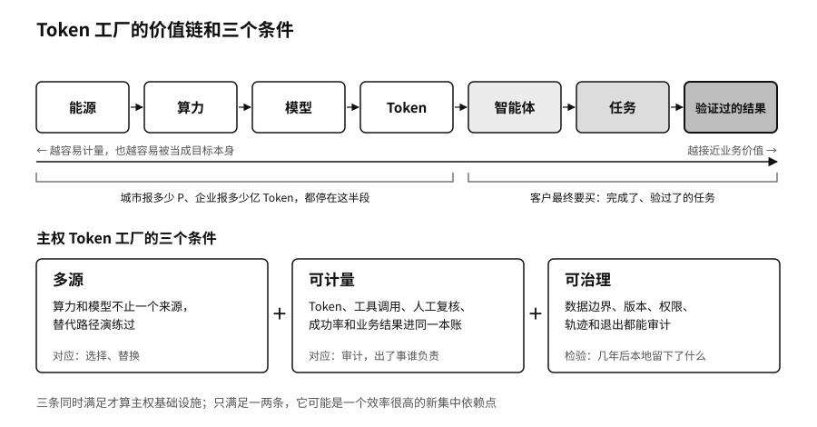

## 三个条件：主权 Token 工厂

一座Token工厂建在本地，用的是本地的电，不等于它就是一块主权基座。如果它只有一种芯片、只跑一家的模型、计量口径由供应商说了算、出了事查不到记录，它只是把依赖从远处挪到了近处。我们认为它至少要满足三个条件。

第一个条件是多源。算力和模型都不能只有一个来源，关键任务要有一条演练过的替代路径。第十章讲国家路线时说过，2026年4月深度求索发布V4当天，八家国产芯片厂商宣布完成适配，这种多源能力是一点一点攒出来的。[^p7-ascend-day0]落到一座工厂上，就是同一个模型服务后面挂着不止一种硬件、不止一个上游，路由层能在它们之间切换。这对应六种能力里的选择和替换。模型网关的多上游和故障切换，是这一层在软件上的样子。

第二个条件是可计量。Token、工具调用、人工复核、任务成功率和业务结果，要进同一套成本账。只算Token单价，一项生成了300个Token却查了5次知识库、最后还要人复核的客服任务，和一项生成了上万个Token却没人用的研究任务，看起来差不多划算。可计量对应的是审计，对应四问里的“出了事谁负责”：钱花在哪里，花出去换回了什么，要有账可查。

第三个条件是可治理。数据的边界、模型的版本、智能体的权限、运行的轨迹，以及哪天要退出时怎样把东西搬走，都要能审计。城市的公共算力平台尤其如此。第十一章讲城市竞争时提出过三种回流：资源回流、资产回流和价值回流。一座Token工厂运营几年以后，本地留下了哪些能维护的模型、测试集、数据产品和懂行的人，是检验它是不是基础设施的硬指标。

三个条件同时满足，Token工厂才算主权基础设施。只满足其中一两条，它可能是一个效率很高的工厂，同时又是一个新的集中依赖点。

拿OpenCSG的方案对一下这三个条件。多源这一条，靠的是模型网关后面挂多个上游、按规则分流和故障切换，算力管理一侧接不同厂商的卡。可计量这一条，靠的是平台按GPU时长和按Token两种口径记账，网关记下每次调用的请求量、费用和时延；任务成功率和业务结果，要从AgenticHub的任务记录和业务部门的验收里接回来。可治理这一条，靠的是模型和数据集在CSGHub里有版本、有权限，智能体的运行轨迹留在AgenticHub里，整套系统可以私有化部署在客户自己的机房。三条里，第三条最依赖客户自己：软件能把记录留下来，有没有人定期去看、去演练退出，是运营的事。

这里也要说清OpenCSG这类软件公司的位置。电从哪里来，芯片买不买得到，机房建在哪里，这些是能源、产业和外交政策的问题，第一章和第十章讲过，软件解决不了。软件能做的，是在这些条件给定以后，让工厂里的模型可以换、账可以算清、记录可以查。

> **行动页｜给你的算力和Token支出算一笔全账**
>
> - 拿出上个月的AI账单，按资源账、任务账、结果账三栏重排，看结果账那一栏有多少是空的。
> - 列出关键任务依赖的芯片、云服务和模型，每一项写下备用来源，没有备用的标红。
> - 挑一项关键任务，让路由层在两个上游之间切换一次，记录质量、时延和成本的变化。
> - 如果你在规划城市或园区的算力项目，把“三年后本地留下了什么”写进验收指标。
