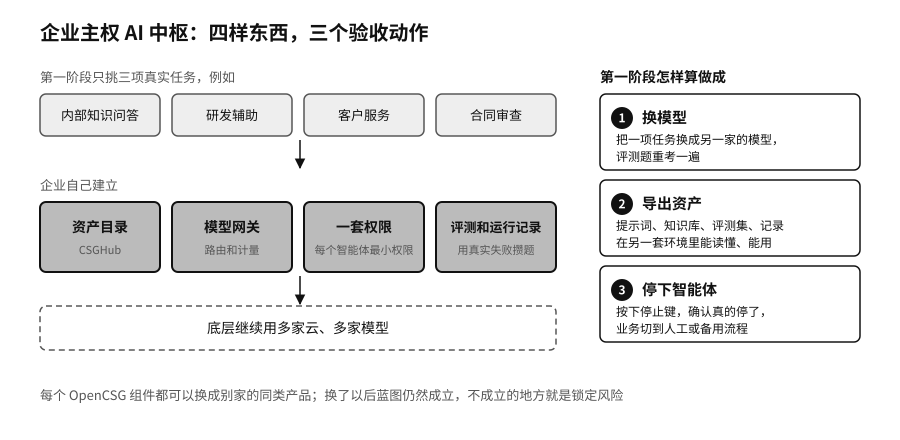

## 企业主权 AI 中枢：统一资产与治理

很多企业用 AI 已经有两三年了，回头一看，模型、数据、提示词、知识库、智能体和评测散在十几个团队和五六家供应商那里。市场部用一家的写作助手，研发用另一家的编程工具，客服外包给了第三家。每个团队都觉得自己的选择很合理，合起来，企业说不清自己有哪些 AI 资产，也说不清哪家供应商停了服务会影响哪些业务。

这套蓝图的目标，是把这些散落的东西收进统一的资产和治理体系。底层可以继续用多家云和多家模型，企业自己建立四样东西：一份资产目录，一个模型网关，一套权限，一套评测和运行记录。在 OpenCSG 的产品里，CSGHub 承担资产层，模型网关承担路由和计量，AgenticHub 承担智能体层，AgenticOps 的方法贯穿发布和运行。

第一阶段不要追求大一统。我们建议挑三项真实任务，比如内部知识问答、研发辅助、客户服务或合同审查，先在这三项上把基本功做扎实：每个用到的数据集有说明书，每个模型有模型卡，每项任务有一套用真实失败攒起来的评测题，每个智能体只拿完成这项任务所需的最小权限。

第一阶段是否完成，用三个动作来验收。第一，换模型：把其中一项任务的底层模型换成另一家的，评测题重考一遍，看质量掉了多少、要改哪些地方。第二，导出资产：把这项任务的提示词、知识库、评测集和运行记录完整导出，在另一套环境里能读懂、能用。第三，停下智能体：按下停止键，确认它真的停了，业务切到人工或备用流程。三个动作都做到了，再扩展到更多业务。

这套蓝图管不到的，是组织本身。资产目录建好了，各团队愿不愿意把自己的东西登记进来，供应商合同里有没有导出条款，停止键交到谁手里，这些要靠管理层推动。第五章讲过，企业大脑式的统一入口有它的诱惑，也有风险：所有资产集中到一处，这一处本身就成了最值钱的攻击目标，权限和隔离要比分散时更严。
