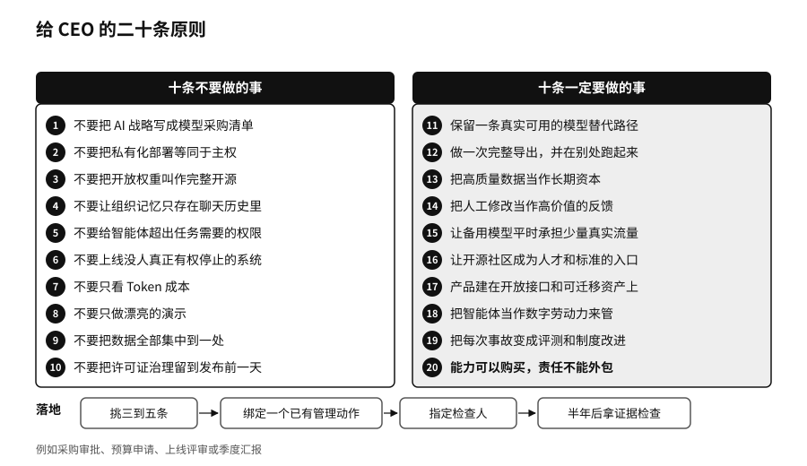

## 二十条原则：写给全公司的规矩

2025年4月7日，Shopify（加拿大电商平台）的创始人兼首席执行官托比·吕特克（Tobi Lütke）把自己发给全体员工的一份内部备忘录贴到了社交媒体X上。其中最常被转述的一句是：在申请更多人手和资源之前，团队必须先说明，为什么他们要做的事不能靠AI完成。[^p26-shopify]

这份备忘录引起很大争议，它至少说明，首席执行官写下的一条原则，改变员工行为的速度往往比一份战略规划快。

吕特克的那句话管的是“用不用”。用到什么程度、用谁的、出了错怎么办、几年后公司手里还剩什么，横跨采购、技术、法务、人力和业务，任何一个部门单独定都定不下来。我们把全书的主张收成二十条，和上面十个问题重合的条目只注明对应哪一问，不再展开。

十条不要做的事：

1. 不要把AI战略写成模型采购清单。战略从公司最重要的任务写起，模型只是手段（第二十一章）。
2. 不要把私有化部署等同于主权。数据不出门，只回答了“看到什么”的一部分（第三章）。
3. 不要把开放权重自动叫作完整开源。能下载参数，不等于许可证允许商用、修改和再分发（第五章、第六章）。
4. 不要让最重要的组织记忆只存在聊天历史里（第十问）。
5. 不要让智能体拥有比任务需要更多的权限。不借员工账号和管理密钥，每项任务领一张到期作废的行动房卡（第十二章）。
6. 不要上线一个没人真正有权停止的自动化系统（第七问）。
7. 不要只看Token成本（第九问）。
8. 不要只做漂亮的演示。评测才能说明它在已知边界内大概率能做（第二十一章）。
9. 不要把数据全部集中到一处。一个“企业大脑”出事时，一个入口能走遍全公司（第十二章）。
10. 不要把许可证治理留到产品发布前一天（第六章）。

十条一定要做的事：

11. 至少保留一条真实可用的模型替代路径（第一问）。
12. 至少做一次数据、提示词、知识和评测的完整导出，并在另一套环境里跑起来（第二问）。
13. 把有来源、有授权记录、能反复用于评测的高质量数据当作长期资本（第三问、第七章）。
14. 把人工修改当作高价值的反馈（第八问）。
15. 让备用模型平时承担少量真实流量（第一问）。
16. 让开源社区成为人才、标准和创新的入口（第九章）。
17. 让商业产品建立在开放接口和可迁移资产之上，采购前先问清离开要付出什么代价（第四章）。
18. 把智能体当作数字劳动力来管理，给它身份、权限、预算和责任人（第六问、第二十二章）。
19. 把每次事故变成评测和制度改进（第八问）。
20. 能力可以购买，责任不能外包。德勤的报告出现AI编造的引文，退还部分费用的是德勤；Cursor的客服机器人编出一条政策，出面澄清的是公司的联合创始人。

这二十条不必一次做到。比较实际的做法，是首席执行官从中挑出三到五条，写进给全体员工的信里，并且说明公司会怎样检查它们有没有落实。吕特克那份备忘录引人注意，很大程度上因为它和人手、资源的申请绑在了一起，员工每次申请都要过一遍。

> **行动页｜下一次董事会前要准备的东西**
>
> - 指定一位高管牵头，把十个问题分给技术、法务、风控和业务部门，各交一页现状、证据和缺口；答不上来的，写明由谁在下一个半年内补齐。
> - 列出公司最关键的五项AI任务，写清每一项依赖哪家模型和平台、谁能叫停、上一次停止演练是哪天。
> - 把能代表公司对外说话或行动的智能体全部列出来，逐个写明权限、预算上限和负责人。
> - 首席执行官从二十条里挑出三到五条写进全员信，每一条绑定一个已有的管理动作，比如采购审批、预算申请或上线评审。
> - 给每条原则指定检查人，半年后的第一次检查挑一条做真实演练，比如一次完整导出或一次停止测试。
