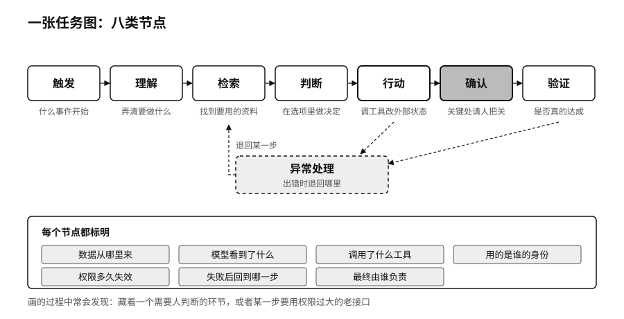

## 任务图：八类节点

选定任务以后，把它拆开画成一张图。一项任务通常可以拆成八类节点：触发，也就是什么事件让任务开始；理解，弄清楚要做什么；检索，找到需要的资料；判断，在几个选项里做决定；行动，调用工具改变外部状态；确认，在关键处请人把关；验证，检查结果是否真的达成；异常处理，出错时退回哪里。

每个节点都要标明几件事：数据从哪里来，模型看到了什么，调用了什么工具，用的是谁的身份，权限多久失效，失败后回到哪一步，最终由谁负责。

这张任务图比一张“AI大平台架构图”更接近真实业务。画的过程中常会发现，原以为简单的任务里藏着一个需要人判断的环节，或者某一步要用到一个权限过大的老接口。这些发现越早越好。
