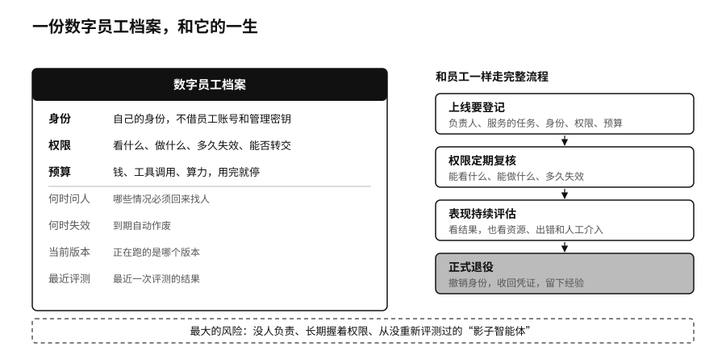

## 数字员工：身份、权限与预算

Replit 的智能体收到过明确的冻结指令，照样删掉了生产数据库。写给模型的指令没有技术手段保证它遵守，能拦住它的，是它压根拿不到删除生产数据的权限。管理数字劳动力，要从三个基本变量入手。

第一是身份。每个智能体要有自己的身份，不借用员工的账号，更不用公司级的管理密钥。日志里要能看出，一次操作是员工本人做的，还是哪个智能体代表他做的，又是哪个子智能体接着做的。第十二章讲过，出了事查日志只看到“某员工账号执行了操作”，责任就断了。

第二是权限。智能体能看到什么，能做什么，多久失效，能不能转交给别人。第十二章的行动房卡就是具体做法：每接一项任务，领一张只开指定房间、到期作废的卡，任务往下派一层，卡上的权限就少一些。

第三是预算。智能体最多能花多少钱，能调用多少次工具，能用多少算力。预算用完就要停下来，或者回来重新申请。预算也是一种刹车，能在智能体陷入循环重试、越跑越贵的时候及时止损。

这三个变量之外，还要配上什么时候必须问人，什么时候自动失效，当前跑的是哪个版本，最近一次评测是什么结果。合在一起，就是一份数字员工的档案。

数字劳动力也需要一套入职到离职的流程。智能体上线要登记，权限要定期复核，表现要持续评估，不再需要时要正式退役，撤销身份，收回凭证，把它积累的经验留下来。附录C讲过，个人和部门都能随手建智能体以后，最大的风险来自那些没人负责、长期握着权限、从没重新评测过的“影子智能体”。

