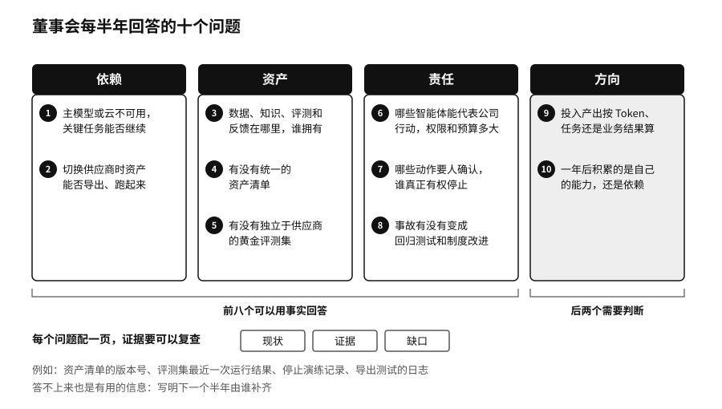

## 十个问题：每半年回答一次

把四件事变成议程，我们建议用十个问题。董事会至少每半年听一次管理层的回答。

第一组问依赖：

1. 我们最关键的五项 AI 任务是什么？如果主要的模型或云服务不可用，它们能不能继续？
2. 供应商切换时，提示词、知识库、评测集、日志、配置和工作流能不能导出？导出以后另一套系统能不能跑起来？

第二组问资产：

3. 最有价值的高质量数据、知识、评测和运行反馈存在哪里？谁拥有，谁维护？
4. 模型、数据、工具、智能体和许可证有没有一份统一的资产清单？
5. 我们有没有一套独立于供应商的“黄金评测集”，也就是从真实业务里挑出来、用来检验任何模型和系统的固定考题？

第三组问责任：

6. 哪些智能体可以代表公司对外行动？它们的权限和预算上限是多少？
7. 哪些动作必须由人确认？谁真正有权停止系统？
8. 真实发生过的事故，有没有变成回归测试和制度上的改进？

第四组问方向：

9. AI 的投入产出，是按 Token 算，按完成的任务算，还是按业务结果算？
10. 一年以后，我们是在积累自己的能力，还是在积累对某个平台的依赖？

这十个问题里，前八个可以用事实回答，后两个需要判断。好的回答应当带着证据。比如第一个问题，管理层不能只说“我们有备用方案”，要说上一次切换演练是哪天做的，用了多少小时，哪些功能降级了，丢了什么数据。第七个问题，要说出停止开关在哪里、按下它的人是谁，以及他上一次真的按下是什么时候。第九个问题，第五章的三本账可以直接拿来用：资源账说明花了多少，任务账说明做成一件事花多少，结果账说明业务到底有没有变好。

第十个问题最难，也最要紧。很多公司三年以后回头看，发现每年都在用最好的模型，自己却什么也没留下：知识写在供应商的配置里，评测题从来没建，员工的经验散落在几千个聊天窗口中。这样的公司换一家供应商，几乎要从头再来。
