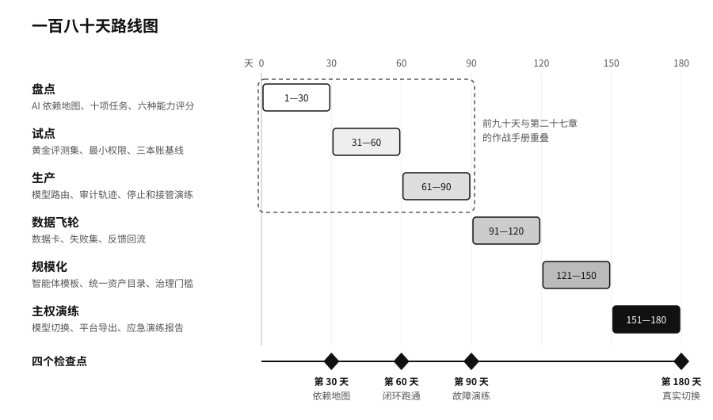

# 第二十四章　180 天企业 AI 主权路线图

二〇二五年十月六日，澳大利亚新南威尔士州重建局（NSW Reconstruction Authority，负责灾后重建的州政府机构）公布了一起数据泄露。当年三月十二日到十五日之间，一名为它工作的承包商把一份 Excel 表格上传到了 ChatGPT。表格有十列、一万两千多行，涉及北河地区（Northern Rivers）“韧性家园计划”最多三千名申请人。这个计划是二〇二二年洪灾以后，帮受灾住户回购、抬高或加固房屋的项目。表格里有姓名、住址、电子邮件、电话，还有一部分个人和健康信息。重建局说，这次上传没有得到授权，目前没有证据显示数据被第三方获取，它已经检查了内部系统，并给员工发了关于未经批准的 AI 平台的指引。[^p24-nsw-chatgpt]

从上传到公布，隔了将近七个月。放在转型的角度看，更值得注意的是另一层：有人早就在用，机构是在资料流出去以后才知道的。哪些人在用、用来做什么、上传过什么，事先没有人统计过。事后发下去的指引能止血，却回答不了下一步该怎么用。

很多企业的 AI 转型都从这个位置起步。员工各自用着几款工具，几个部门各自签了供应商，一两个试点项目在做演示，没人说得清公司整体依赖了什么。这一章给出一份一百八十天的路线图，从摸清事实开始，到第一次真实的替换和退出演练结束。

| 阶段 | 时间 | 重点 | 关键交付 |
|---|---|---|---|
| 盘点 | 第 1—30 天 | 任务、资产、数据、依赖、风险 | AI 依赖地图；最重要的十项任务；按六种能力打的第一次分 |
| 试点 | 第 31—60 天 | 三到五项真实的智能体任务 | 黄金评测集；最小权限；三本账的基线 |
| 生产 | 第 61—90 天 | 控制面、监控、备用路径 | 模型路由；审计轨迹；停止和接管演练 |
| 数据飞轮 | 第 91—120 天 | 高质量数据和反馈闭环 | 数据卡；失败集；反馈回流 |
| 规模化 | 第 121—150 天 | 模板化、平台化、跨部门 | 智能体模板；统一资产目录；治理门槛 |
| 主权演练 | 第 151—180 天 | 迁移、替换、事故和退出 | 模型切换；平台导出；应急演练报告 |

前九十天和第二十七章的作战手册有重叠。作战手册站在一个项目团队的位置，讲怎样把几项任务做成；这一章站在公司的位置，讲这些项目之外，管理层要同时建立哪些事实和能力。

