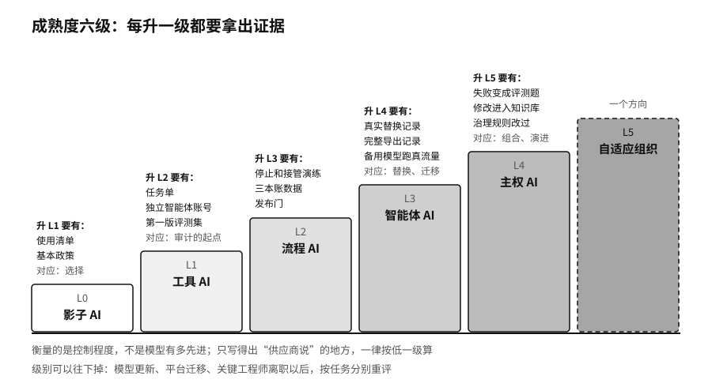

## 定级的办法：拿证据对照

给自己定级，最常见的毛病是凭感觉。部门负责人说“我们的智能体是可控的”，问他依据是什么，往往只有一句“供应商说有安全机制”。

我们建议每升一级，都要拿出能复查的证据，并且对照第三章的六种能力来看。

从零级到一级，要有一份 AI 使用清单和一份基本政策，说明哪些资料不能上传，哪些工具是公司认可的。这对应的是“选择”：看清了才谈得上选。

从一级到二级，要有写清楚的任务单、独立的智能体账号和第一版评测集。这对应“审计”的起点：出了事，能查到是哪个任务、哪个身份、哪个版本。

从二级到三级，要有停止开关和人工接管的演练记录，有三本账的数据，有发布门。没有这些证据，就不该放智能体去持续执行任务。

从三级到四级，要有一次真实的模型替换记录和一次完整的资产导出记录，备用模型平时承担一部分真实流量。这对应“替换”和“迁移”。很多公司卡在这一级之前，原因是从没真的换过。

从四级到五级，要能说明过去一段时间里，有多少真实失败变成了评测题，有多少人工修改进入了知识库或规则，治理规则因此改过几次。这对应“组合”和“演进”。

定级的结果最好分任务列出，不必给整个公司一个总分。一张表上，左边是十项关键任务，右边是每项任务现在的级别、证据和下一级缺什么。这张表可以直接放进董事会的半年汇报。

> **行动页｜给自家公司定一次级**
>
> - 从第二十四章的依赖地图里取出十项关键任务，逐项写下现在的级别和支撑这个级别的证据。
> - 凡是只能写出“供应商说”的地方，一律按低一级处理，记下要补的证据。
> - 给每项任务定一个级别上限，写清为什么不该更高，比如动作撤不回来、影响的人很多。
> - 半年后用同一张表重评一次，特别留意哪些任务因为模型更新或人员变动掉了级。
