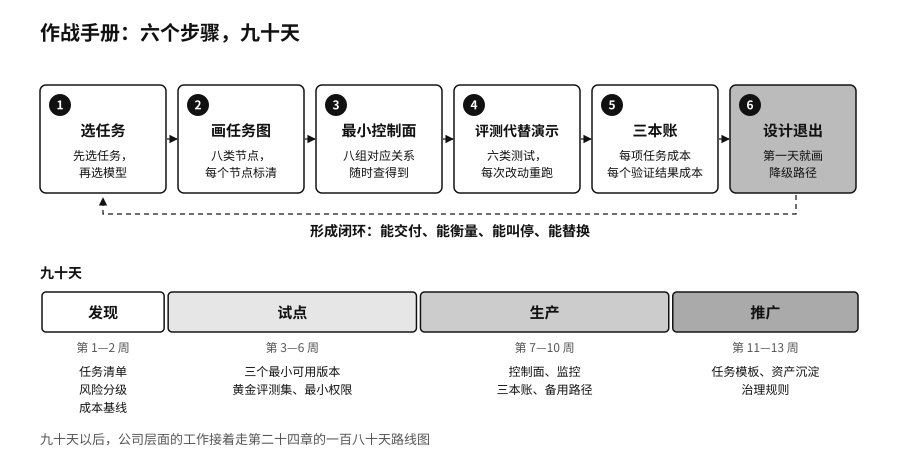

## 九十天路线图：让三到五项任务形成闭环

九十天的目标，不必是“上线一个 AI 平台”。比较实际的目标，是让三到五项真实的业务任务形成可以重复的闭环，并且证明它们能交付，能衡量，能叫停，能替换，能复盘，还能接着改进。

| 阶段 | 时间 | 交付物 | 董事会要问的问题 |
|---|---|---|---|
| 发现 | 第 1—2 周 | 任务清单、风险分级、成本基线 | 我们在解决业务问题，还是在做技术展示？ |
| 试点 | 第 3—6 周 | 三个智能体的最小可用版本、黄金评测集、最小权限 | 它能做成吗？出错时能停下来吗？ |
| 生产 | 第 7—10 周 | 控制面、监控、三本账、备用路径 | 它能稳定运行吗？投入产出算得过来吗？ |
| 推广 | 第 11—13 周 | 任务模板、资产沉淀、治理规则、扩展计划 | 能力是沉淀在公司里，还是沉淀在供应商那里？ |

头两周用来发现。从业务部门收集候选任务，按第一步的标准筛选，给每项任务做风险分级，测出人工完成它现在要花多少钱和时间。

第三到第六周做试点。挑出三项任务，画任务图，配最小权限，建黄金评测集，做出能跑通完整闭环的最小版本。这一阶段结束时，每项任务都要有一份评测报告和一次停止演练的记录。

第七到第十周进生产。把控制面补齐，接上监控，开始记三本账，让备用模型承担一部分流量，并做一次断掉主模型的演练。

最后三周做推广的准备。把三项任务的做法整理成模板，把评测集、提示词、知识和权限策略收进公司的资产目录，定出其他部门照着做时要过的门槛。

九十天以后，公司层面的工作还要接着往下走，第二十四章的一百八十天路线图讲的是这一部分。

> **行动页｜下周一就能开始的事**
>
> - 召集两三个业务部门，每个部门报一项做得频繁、结果能检查、出错能挽回的任务，并测出现在的人工成本。
> - 给选中的任务画一张八类节点的任务图，在每个节点上标出数据来源、身份、权限和负责人。
> - 从历史记录里挑出五十个真实案例，其中至少十个是过去出过错的，作为第一版黄金评测集。
> - 定下三个数字：每完成一项任务的成本、每个经过验证的结果的成本，以及三个月后要回头复查的结果指标。
