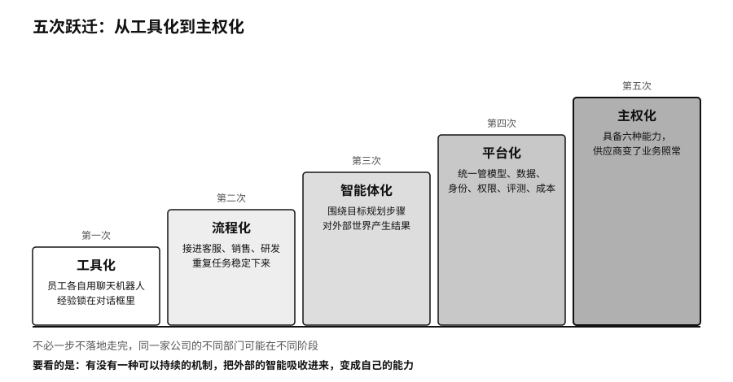

## 五次跃迁：从工具化到主权化

从员工各自用聊天机器人，到组织能够管住会行动的机器，企业通常要走过五个阶段。第二十五章的成熟度模型看的是控制程度，这里换一个角度，看组织能力是怎样一步步长出来的。

第一次跃迁是工具化。员工个人用聊天机器人写东西、查资料、做翻译、写代码。价值来得很快，组织里沉淀下来的东西却很少，每个人的经验都锁在自己的对话框里。

第二次跃迁是流程化。企业把 AI 接进客服、销售、研发、运营的流程，用知识库、业务接口和工作流让重复的任务稳定下来。Klarna 的客服助手就在这一步（见第二十七章）。

第三次跃迁是智能体化。AI 不再只给建议，它围绕目标规划步骤，调用工具，等待外部事件，接着执行，对外部世界产生结果。第三章讲过从回答到任务的这个变化。

第四次跃迁是平台化。企业开始统一管理模型、数据、提示词、知识、工具、身份、权限、评测、成本和运行轨迹。莫德纳三千多个 GPT 如果各自为政，就很难说清哪个在用、谁负责、用了什么数据，平台化要解决的正是这种分散。

第五次跃迁是主权化。企业具备了第三章说的六种能力，能选择，能替换，能迁移，能审计，能组合，能演进。即使模型、供应商或监管环境变了，关键业务仍能继续。

这五次跃迁不必一步不落地依次走完，同一家公司的不同部门也可能处在不同阶段。它们指向的方向是一致的。多少员工开通了 AI 账号，说明不了转型走到了哪里；要看的是组织有没有一种可以持续的机制，把外部的智能吸收进来，变成自己的能力。
